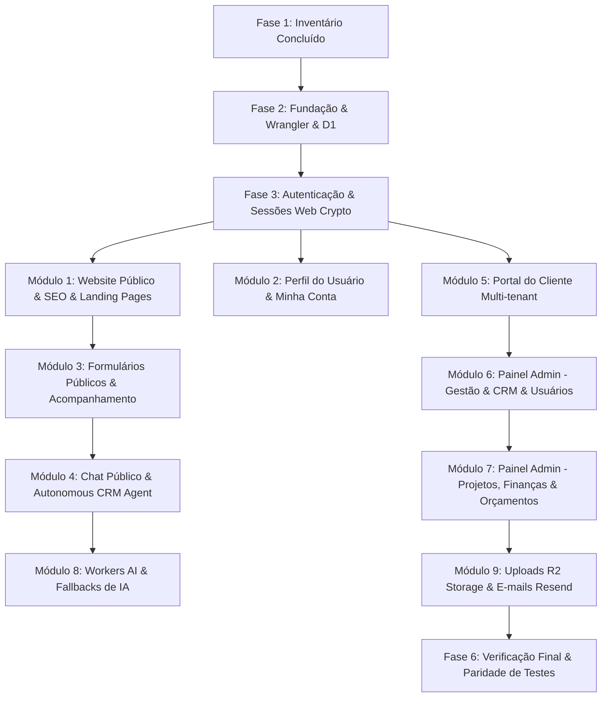

# MIGRATION.md — Inventário Completo de Migração para Cloudflare Workers
> **Destino:** Cloudflare Workers (TypeScript + Hono) + Cloudflare D1 (SQLite) + Cloudflare R2 (Storage) + Cloudflare KV (Cache/Sessions) + Workers AI + Cloudflare Access
> **Status:** FASE 1 — INVENTÁRIO COMPLETO CONCLUÍDO (Nenhum código de migração escrito, sem deploy)

---
## 1. Rotas da Aplicação (Web + API)
Total de rotas mapeadas: **162 rotas**.

### Public / Marketing / SEO (51 rotas)
| Método | Caminho (Path) | Nome da Rota | Controller / Action | Middleware |
|---|---|---|---|---|
| `GET|HEAD` | `/` | `home` | `App\Http\Controllers\PublicController@index` | `web` |
| `POST` | `/_boost/browser-logs` | `boost.browser-logs` | `Closure` | `` |
| `GET|HEAD` | `/acompanhar-solicitacao` | `track.request` | `App\Http\Controllers\PublicController@trackRequest` | `web, Illuminate\Routing\Middleware\ThrottleRequests:30,1` |
| `GET|HEAD` | `/autor-{slug}` | `-` | `App\Http\Controllers\PublicController@authorDetail` | `web` |
| `GET|HEAD` | `/blog` | `blog` | `App\Http\Controllers\PublicController@blog` | `web` |
| `GET|HEAD` | `/blog/{slug}` | `blog.show` | `App\Http\Controllers\PublicController@blogPost` | `web` |
| `GET|HEAD|POST|PUT|PATCH|DELETE|OPTIONS|QUERY` | `/cadastrar` | `-` | `Illuminate\Routing\RedirectController` | `web` |
| `GET|HEAD` | `/cadastro` | `register` | `App\Http\Controllers\Auth\AuthController@showRegister` | `web` |
| `POST` | `/cadastro` | `-` | `App\Http\Controllers\Auth\AuthController@register` | `web, Illuminate\Routing\Middleware\ThrottleRequests:10,1` |
| `GET|HEAD` | `/cases` | `-` | `App\Http\Controllers\PublicController@portfolio` | `web` |
| `GET|HEAD` | `/cases/{slug}` | `-` | `App\Http\Controllers\PublicController@caseDetail` | `web` |
| `GET|HEAD` | `/ciberseguranca` | `-` | `Closure` | `web` |
| `GET|HEAD|POST|PUT|PATCH|DELETE|OPTIONS|QUERY` | `/cliente` | `-` | `Illuminate\Routing\RedirectController` | `web` |
| `GET|HEAD` | `/contato` | `contact` | `App\Http\Controllers\PublicController@contact` | `web` |
| `POST` | `/contato` | `contact.send` | `App\Http\Controllers\PublicController@sendContact` | `web, Illuminate\Routing\Middleware\ThrottleRequests:20,1` |
| `GET|HEAD` | `/criacao-de-sites` | `-` | `Closure` | `web` |
| `GET|HEAD` | `/criacao-de-sites-alphaville` | `-` | `Closure` | `web` |
| `GET|HEAD` | `/criacao-de-sites-wordpress` | `-` | `Closure` | `web` |
| `GET|HEAD` | `/desenvolvimento-de-sites` | `-` | `Closure` | `web` |
| `GET|HEAD` | `/en/{path?}` | `-` | `Closure` | `web` |
| `GET|HEAD` | `/esqueci-minha-senha` | `password.request` | `App\Http\Controllers\Auth\AuthController@showForgotPassword` | `web` |
| `POST` | `/esqueci-minha-senha` | `password.email` | `App\Http\Controllers\Auth\AuthController@sendResetLink` | `web, Illuminate\Routing\Middleware\ThrottleRequests:10,1` |
| `GET|HEAD` | `/feed.xml` | `feed` | `App\Http\Controllers\PublicController@feed` | `web` |
| `GET|HEAD` | `/livewire-9f233436/css/{component}.css` | `-` | `Closure` | `` |
| `GET|HEAD` | `/livewire-9f233436/css/{component}.global.css` | `-` | `Closure` | `` |
| `GET|HEAD` | `/livewire-9f233436/js/{component}.js` | `-` | `Closure` | `` |
| `GET|HEAD` | `/livewire-9f233436/livewire.csp.min.js.map` | `-` | `Livewire\Mechanisms\FrontendAssets\FrontendAssets@cspMaps` | `` |
| `GET|HEAD` | `/livewire-9f233436/livewire.js` | `-` | `Livewire\Mechanisms\FrontendAssets\FrontendAssets@returnJavaScriptAsFile` | `` |
| `GET|HEAD` | `/livewire-9f233436/livewire.min.js.map` | `-` | `Livewire\Mechanisms\FrontendAssets\FrontendAssets@maps` | `` |
| `GET|HEAD` | `/livewire-9f233436/preview-file/{filename}` | `livewire.preview-file` | `Livewire\Features\SupportFileUploads\FilePreviewController@handle` | `web` |
| `POST` | `/livewire-9f233436/update` | `default-livewire.update` | `Livewire\Mechanisms\HandleRequests\HandleRequests@handleUpdate` | `web, Livewire\Mechanisms\HandleRequests\RequireLivewireHeaders` |
| `POST` | `/livewire-9f233436/upload-file` | `livewire.upload-file` | `Livewire\Features\SupportFileUploads\FileUploadController@handle` | `web, Illuminate\Routing\Middleware\ThrottleRequests:60,1` |
| `GET|HEAD` | `/operacao` | `-` | `Closure` | `web` |
| `GET|HEAD` | `/politica-de-privacidade` | `-` | `Closure` | `web` |
| `GET|HEAD` | `/portfolio` | `portfolio` | `App\Http\Controllers\PublicController@portfolio` | `web` |
| `GET|HEAD` | `/portfolio/{slug}` | `-` | `App\Http\Controllers\PublicController@caseDetail` | `web` |
| `GET|HEAD` | `/pt-pt/{path?}` | `-` | `Closure` | `web` |
| `GET|HEAD` | `/quanto-custa-um-site` | `-` | `Closure` | `web` |
| `POST` | `/redefinir-senha` | `password.update` | `App\Http\Controllers\Auth\AuthController@resetPassword` | `web, Illuminate\Routing\Middleware\ThrottleRequests:10,1` |
| `GET|HEAD` | `/redefinir-senha/{token}` | `password.reset` | `App\Http\Controllers\Auth\AuthController@showResetPassword` | `web` |
| `GET|HEAD` | `/servicos` | `services` | `App\Http\Controllers\PublicController@services` | `web` |
| `GET|HEAD` | `/servicos/{slug}` | `services.show` | `App\Http\Controllers\PublicController@serviceDetail` | `web` |
| `GET|HEAD` | `/sitemap.xml` | `sitemap` | `App\Http\Controllers\PublicController@sitemap` | `web` |
| `GET|HEAD` | `/sobre` | `about` | `App\Http\Controllers\PublicController@about` | `web` |
| `GET|HEAD` | `/sobre-nos` | `-` | `App\Http\Controllers\PublicController@about` | `web` |
| `GET|HEAD` | `/solicitar-orcamento` | `request.quote` | `App\Http\Controllers\PublicController@requestQuote` | `web` |
| `POST` | `/solicitar-orcamento` | `request.store` | `App\Http\Controllers\PublicController@storeRequest` | `web, Illuminate\Routing\Middleware\ThrottleRequests:20,1` |
| `GET|HEAD` | `/storage/{path}` | `storage.local` | `Closure` | `` |
| `PUT` | `/storage/{path}` | `storage.local.upload` | `Closure` | `` |
| `GET|HEAD` | `/up` | `-` | `Illuminate\Foundation\Http\HealthCheck` | `` |
| `GET|HEAD` | `/{slug}` | `-` | `App\Http\Controllers\PublicController@blogPost` | `web` |

### Autenticação / Conta (6 rotas)
| Método | Caminho (Path) | Nome da Rota | Controller / Action | Middleware |
|---|---|---|---|---|
| `GET|HEAD` | `/login` | `login` | `App\Http\Controllers\Auth\AuthController@showLogin` | `web` |
| `POST` | `/login` | `-` | `App\Http\Controllers\Auth\AuthController@login` | `web, Illuminate\Routing\Middleware\ThrottleRequests:10,1` |
| `POST` | `/logout` | `logout` | `App\Http\Controllers\Auth\AuthController@logout` | `web` |
| `GET|HEAD` | `/minha-conta` | `account.edit` | `App\Http\Controllers\AccountController@edit` | `web, Illuminate\Auth\Middleware\Authenticate` |
| `PUT` | `/minha-conta/perfil` | `account.profile.update` | `App\Http\Controllers\AccountController@updateProfile` | `web, Illuminate\Auth\Middleware\Authenticate` |
| `PUT` | `/minha-conta/senha` | `account.password.update` | `App\Http\Controllers\AccountController@updatePassword` | `web, Illuminate\Auth\Middleware\Authenticate, Illuminate\Routing\Middleware\ThrottleRequests:10,1` |

### API Pública / CRM / Chat (5 rotas)
| Método | Caminho (Path) | Nome da Rota | Controller / Action | Middleware |
|---|---|---|---|---|
| `POST` | `/api/chat/message` | `api.chat.message` | `App\Http\Controllers\PublicController@apiChatMessage` | `web, Illuminate\Routing\Middleware\ThrottleRequests:30,1` |
| `GET|HEAD` | `/api/chat/messages` | `api.chat.messages` | `App\Http\Controllers\PublicController@apiChatMessages` | `web, Illuminate\Routing\Middleware\ThrottleRequests:60,1` |
| `POST` | `/api/chat/start` | `api.chat.start` | `App\Http\Controllers\PublicController@apiChatStart` | `web, Illuminate\Routing\Middleware\ThrottleRequests:20,1` |
| `POST` | `/api/lead` | `api.lead` | `App\Http\Controllers\PublicController@apiLead` | `web, Illuminate\Routing\Middleware\ThrottleRequests:20,1` |
| `POST` | `/api/whatsapp` | `api.whatsapp` | `App\Http\Controllers\PublicController@apiWhatsapp` | `web, Illuminate\Routing\Middleware\ThrottleRequests:30,1` |

### Admin (Painel Administrativo) (80 rotas)
| Método | Caminho (Path) | Nome da Rota | Controller / Action | Middleware |
|---|---|---|---|---|
| `GET|HEAD` | `/admin` | `admin.dashboard` | `App\Http\Controllers\Admin\AdminDashboardController@index` | `web, Illuminate\Auth\Middleware\Authenticate, App\Http\Middleware\AdminMiddleware, App\Http\Middleware\PermissionMiddleware:admin.dashboard.view` |
| `GET|HEAD` | `/admin/atendimento` | `admin.chat.index` | `App\Http\Controllers\Admin\AdminChatController@index` | `web, Illuminate\Auth\Middleware\Authenticate, App\Http\Middleware\AdminMiddleware, App\Http\Middleware\PermissionMiddleware:chat.view` |
| `POST` | `/admin/atendimento/iniciar` | `admin.chat.start` | `App\Http\Controllers\Admin\AdminChatController@startConversation` | `web, Illuminate\Auth\Middleware\Authenticate, App\Http\Middleware\AdminMiddleware, App\Http\Middleware\PermissionMiddleware:chat.manage` |
| `GET|HEAD` | `/admin/atendimento/resumo` | `admin.chat.summary` | `App\Http\Controllers\Admin\AdminChatController@summary` | `web, Illuminate\Auth\Middleware\Authenticate, App\Http\Middleware\AdminMiddleware, App\Http\Middleware\PermissionMiddleware:chat.view` |
| `DELETE` | `/admin/atendimento/{conversation}` | `admin.chat.destroy` | `App\Http\Controllers\Admin\AdminChatController@destroy` | `web, Illuminate\Auth\Middleware\Authenticate, App\Http\Middleware\AdminMiddleware, App\Http\Middleware\PermissionMiddleware:chat.manage` |
| `POST` | `/admin/atendimento/{conversation}/fechar` | `admin.chat.close` | `App\Http\Controllers\Admin\AdminChatController@closeConversation` | `web, Illuminate\Auth\Middleware\Authenticate, App\Http\Middleware\AdminMiddleware, App\Http\Middleware\PermissionMiddleware:chat.manage` |
| `POST` | `/admin/atendimento/{conversation}/mensagem` | `admin.chat.send` | `App\Http\Controllers\Admin\AdminChatController@sendMessage` | `web, Illuminate\Auth\Middleware\Authenticate, App\Http\Middleware\AdminMiddleware, App\Http\Middleware\PermissionMiddleware:chat.manage` |
| `GET|HEAD` | `/admin/atendimento/{conversation}/mensagens` | `admin.chat.messages` | `App\Http\Controllers\Admin\AdminChatController@messages` | `web, Illuminate\Auth\Middleware\Authenticate, App\Http\Middleware\AdminMiddleware, App\Http\Middleware\PermissionMiddleware:chat.view` |
| `POST` | `/admin/atendimento/{conversation}/reabrir` | `admin.chat.reopen` | `App\Http\Controllers\Admin\AdminChatController@reopenConversation` | `web, Illuminate\Auth\Middleware\Authenticate, App\Http\Middleware\AdminMiddleware, App\Http\Middleware\PermissionMiddleware:chat.manage` |
| `POST` | `/admin/atendimento/{conversation}/toggle-ai` | `admin.chat.toggle-ai` | `App\Http\Controllers\Admin\AdminChatController@toggleAi` | `web, Illuminate\Auth\Middleware\Authenticate, App\Http\Middleware\AdminMiddleware, App\Http\Middleware\PermissionMiddleware:chat.manage` |
| `POST` | `/admin/campanhas` | `admin.campaigns.store` | `App\Http\Controllers\Admin\AdminCampaignController@store` | `web, Illuminate\Auth\Middleware\Authenticate, App\Http\Middleware\AdminMiddleware, App\Http\Middleware\PermissionMiddleware:campaigns.manage` |
| `GET|HEAD` | `/admin/campanhas` | `admin.campaigns.index` | `App\Http\Controllers\Admin\AdminCampaignController@index` | `web, Illuminate\Auth\Middleware\Authenticate, App\Http\Middleware\AdminMiddleware, App\Http\Middleware\PermissionMiddleware:campaigns.view` |
| `DELETE` | `/admin/campanhas/{campaign}` | `admin.campaigns.destroy` | `App\Http\Controllers\Admin\AdminCampaignController@destroy` | `web, Illuminate\Auth\Middleware\Authenticate, App\Http\Middleware\AdminMiddleware, App\Http\Middleware\PermissionMiddleware:campaigns.manage` |
| `GET|HEAD` | `/admin/campanhas/{campaign}` | `admin.campaigns.show` | `App\Http\Controllers\Admin\AdminCampaignController@show` | `web, Illuminate\Auth\Middleware\Authenticate, App\Http\Middleware\AdminMiddleware, App\Http\Middleware\PermissionMiddleware:campaigns.view` |
| `POST` | `/admin/campanhas/{campaign}/metricas` | `admin.campaigns.metrics` | `App\Http\Controllers\Admin\AdminCampaignController@addMetrics` | `web, Illuminate\Auth\Middleware\Authenticate, App\Http\Middleware\AdminMiddleware, App\Http\Middleware\PermissionMiddleware:campaigns.manage` |
| `PUT` | `/admin/campanhas/{campaign}/status` | `admin.campaigns.status` | `App\Http\Controllers\Admin\AdminCampaignController@updateStatus` | `web, Illuminate\Auth\Middleware\Authenticate, App\Http\Middleware\AdminMiddleware, App\Http\Middleware\PermissionMiddleware:campaigns.manage` |
| `POST` | `/admin/clientes` | `admin.clients.store` | `App\Http\Controllers\Admin\AdminClientController@store` | `web, Illuminate\Auth\Middleware\Authenticate, App\Http\Middleware\AdminMiddleware, App\Http\Middleware\PermissionMiddleware:clients.manage` |
| `GET|HEAD` | `/admin/clientes` | `admin.clients.index` | `App\Http\Controllers\Admin\AdminClientController@index` | `web, Illuminate\Auth\Middleware\Authenticate, App\Http\Middleware\AdminMiddleware, App\Http\Middleware\PermissionMiddleware:clients.view` |
| `GET|HEAD` | `/admin/clientes/novo` | `admin.clients.create` | `App\Http\Controllers\Admin\AdminClientController@create` | `web, Illuminate\Auth\Middleware\Authenticate, App\Http\Middleware\AdminMiddleware, App\Http\Middleware\PermissionMiddleware:clients.manage` |
| `PUT` | `/admin/clientes/{client}` | `admin.clients.update` | `App\Http\Controllers\Admin\AdminClientController@update` | `web, Illuminate\Auth\Middleware\Authenticate, App\Http\Middleware\AdminMiddleware, App\Http\Middleware\PermissionMiddleware:clients.manage` |
| `DELETE` | `/admin/clientes/{client}` | `admin.clients.destroy` | `App\Http\Controllers\Admin\AdminClientController@destroy` | `web, Illuminate\Auth\Middleware\Authenticate, App\Http\Middleware\AdminMiddleware, App\Http\Middleware\PermissionMiddleware:clients.manage` |
| `GET|HEAD` | `/admin/clientes/{client}` | `admin.clients.show` | `App\Http\Controllers\Admin\AdminClientController@show` | `web, Illuminate\Auth\Middleware\Authenticate, App\Http\Middleware\AdminMiddleware, App\Http\Middleware\PermissionMiddleware:clients.view` |
| `GET|HEAD` | `/admin/clientes/{client}/editar` | `admin.clients.edit` | `App\Http\Controllers\Admin\AdminClientController@edit` | `web, Illuminate\Auth\Middleware\Authenticate, App\Http\Middleware\AdminMiddleware, App\Http\Middleware\PermissionMiddleware:clients.manage` |
| `GET|HEAD` | `/admin/crm-autonomo` | `admin.crm.index` | `App\Http\Controllers\Admin\AdminAutonomousCrmController@index` | `web, Illuminate\Auth\Middleware\Authenticate, App\Http\Middleware\AdminMiddleware, App\Http\Middleware\PermissionMiddleware:chat.view` |
| `PUT` | `/admin/crm-autonomo/configuracoes` | `admin.crm.settings` | `App\Http\Controllers\Admin\AdminAutonomousCrmController@updateSettings` | `web, Illuminate\Auth\Middleware\Authenticate, App\Http\Middleware\AdminMiddleware, App\Http\Middleware\PermissionMiddleware:settings.manage` |
| `POST` | `/admin/crm-autonomo/testar` | `admin.crm.test` | `App\Http\Controllers\Admin\AdminAutonomousCrmController@testConnection` | `web, Illuminate\Auth\Middleware\Authenticate, App\Http\Middleware\AdminMiddleware, App\Http\Middleware\PermissionMiddleware:settings.manage` |
| `POST` | `/admin/dominios` | `admin.domains.store` | `App\Http\Controllers\Admin\AdminDomainController@store` | `web, Illuminate\Auth\Middleware\Authenticate, App\Http\Middleware\AdminMiddleware, App\Http\Middleware\PermissionMiddleware:domains.manage` |
| `GET|HEAD` | `/admin/dominios` | `admin.domains.index` | `App\Http\Controllers\Admin\AdminDomainController@index` | `web, Illuminate\Auth\Middleware\Authenticate, App\Http\Middleware\AdminMiddleware, App\Http\Middleware\PermissionMiddleware:domains.view` |
| `DELETE` | `/admin/dominios/dns/{dnsRecord}` | `admin.domains.dns.destroy` | `App\Http\Controllers\Admin\AdminDomainController@deleteDnsRecord` | `web, Illuminate\Auth\Middleware\Authenticate, App\Http\Middleware\AdminMiddleware, App\Http\Middleware\PermissionMiddleware:domains.manage` |
| `DELETE` | `/admin/dominios/{domain}` | `admin.domains.destroy` | `App\Http\Controllers\Admin\AdminDomainController@destroy` | `web, Illuminate\Auth\Middleware\Authenticate, App\Http\Middleware\AdminMiddleware, App\Http\Middleware\PermissionMiddleware:domains.manage` |
| `GET|HEAD` | `/admin/dominios/{domain}` | `admin.domains.show` | `App\Http\Controllers\Admin\AdminDomainController@show` | `web, Illuminate\Auth\Middleware\Authenticate, App\Http\Middleware\AdminMiddleware, App\Http\Middleware\PermissionMiddleware:domains.view` |
| `POST` | `/admin/dominios/{domain}/dns` | `admin.domains.dns` | `App\Http\Controllers\Admin\AdminDomainController@addDnsRecord` | `web, Illuminate\Auth\Middleware\Authenticate, App\Http\Middleware\AdminMiddleware, App\Http\Middleware\PermissionMiddleware:domains.manage` |
| `POST` | `/admin/dominios/{domain}/renovar` | `admin.domains.renew` | `App\Http\Controllers\Admin\AdminDomainController@renewDomain` | `web, Illuminate\Auth\Middleware\Authenticate, App\Http\Middleware\AdminMiddleware, App\Http\Middleware\PermissionMiddleware:domains.manage` |
| `GET|HEAD` | `/admin/financeiro` | `admin.finance.index` | `App\Http\Controllers\Admin\AdminFinanceController@index` | `web, Illuminate\Auth\Middleware\Authenticate, App\Http\Middleware\AdminMiddleware, App\Http\Middleware\PermissionMiddleware:finance.view` |
| `POST` | `/admin/financeiro/transacoes` | `admin.finance.store` | `App\Http\Controllers\Admin\AdminFinanceController@store` | `web, Illuminate\Auth\Middleware\Authenticate, App\Http\Middleware\AdminMiddleware, App\Http\Middleware\PermissionMiddleware:finance.manage` |
| `DELETE` | `/admin/financeiro/transacoes/{transaction}` | `admin.finance.destroy` | `App\Http\Controllers\Admin\AdminFinanceController@destroy` | `web, Illuminate\Auth\Middleware\Authenticate, App\Http\Middleware\AdminMiddleware, App\Http\Middleware\PermissionMiddleware:finance.manage` |
| `POST` | `/admin/financeiro/transacoes/{transaction}/pagar` | `admin.finance.pay` | `App\Http\Controllers\Admin\AdminFinanceController@markAsPaid` | `web, Illuminate\Auth\Middleware\Authenticate, App\Http\Middleware\AdminMiddleware, App\Http\Middleware\PermissionMiddleware:finance.manage` |
| `POST` | `/admin/orcamentos` | `admin.quotations.store` | `App\Http\Controllers\Admin\AdminQuotationController@store` | `web, Illuminate\Auth\Middleware\Authenticate, App\Http\Middleware\AdminMiddleware, App\Http\Middleware\PermissionMiddleware:quotations.manage` |
| `GET|HEAD` | `/admin/orcamentos` | `admin.quotations.index` | `App\Http\Controllers\Admin\AdminQuotationController@index` | `web, Illuminate\Auth\Middleware\Authenticate, App\Http\Middleware\AdminMiddleware, App\Http\Middleware\PermissionMiddleware:quotations.view` |
| `GET|HEAD` | `/admin/orcamentos/novo` | `admin.quotations.create` | `App\Http\Controllers\Admin\AdminQuotationController@create` | `web, Illuminate\Auth\Middleware\Authenticate, App\Http\Middleware\AdminMiddleware, App\Http\Middleware\PermissionMiddleware:quotations.manage` |
| `DELETE` | `/admin/orcamentos/{quotation}` | `admin.quotations.destroy` | `App\Http\Controllers\Admin\AdminQuotationController@destroy` | `web, Illuminate\Auth\Middleware\Authenticate, App\Http\Middleware\AdminMiddleware, App\Http\Middleware\PermissionMiddleware:quotations.manage` |
| `GET|HEAD` | `/admin/orcamentos/{quotation}` | `admin.quotations.show` | `App\Http\Controllers\Admin\AdminQuotationController@show` | `web, Illuminate\Auth\Middleware\Authenticate, App\Http\Middleware\AdminMiddleware, App\Http\Middleware\PermissionMiddleware:quotations.view` |
| `POST` | `/admin/orcamentos/{quotation}/converter` | `admin.quotations.convert` | `App\Http\Controllers\Admin\AdminQuotationController@convertToProject` | `web, Illuminate\Auth\Middleware\Authenticate, App\Http\Middleware\AdminMiddleware, App\Http\Middleware\PermissionMiddleware:quotations.manage` |
| `POST` | `/admin/orcamentos/{quotation}/status` | `admin.quotations.status` | `App\Http\Controllers\Admin\AdminQuotationController@updateStatus` | `web, Illuminate\Auth\Middleware\Authenticate, App\Http\Middleware\AdminMiddleware, App\Http\Middleware\PermissionMiddleware:quotations.manage` |
| `GET|HEAD` | `/admin/permissoes` | `admin.permissions.index` | `App\Http\Controllers\Admin\AdminPermissionController@index` | `web, Illuminate\Auth\Middleware\Authenticate, App\Http\Middleware\AdminMiddleware, App\Http\Middleware\PermissionMiddleware:settings.manage` |
| `PUT` | `/admin/permissoes` | `admin.permissions.update` | `App\Http\Controllers\Admin\AdminPermissionController@update` | `web, Illuminate\Auth\Middleware\Authenticate, App\Http\Middleware\AdminMiddleware, App\Http\Middleware\PermissionMiddleware:settings.manage` |
| `POST` | `/admin/permissoes/padrao` | `admin.permissions.reset` | `App\Http\Controllers\Admin\AdminPermissionController@resetDefaults` | `web, Illuminate\Auth\Middleware\Authenticate, App\Http\Middleware\AdminMiddleware, App\Http\Middleware\PermissionMiddleware:settings.manage` |
| `POST` | `/admin/projetos` | `admin.projects.store` | `App\Http\Controllers\Admin\AdminProjectController@store` | `web, Illuminate\Auth\Middleware\Authenticate, App\Http\Middleware\AdminMiddleware, App\Http\Middleware\PermissionMiddleware:projects.manage` |
| `GET|HEAD` | `/admin/projetos` | `admin.projects.index` | `App\Http\Controllers\Admin\AdminProjectController@index` | `web, Illuminate\Auth\Middleware\Authenticate, App\Http\Middleware\AdminMiddleware, App\Http\Middleware\PermissionMiddleware:projects.view` |
| `POST` | `/admin/projetos/etapas/{stage}` | `admin.projects.stage` | `App\Http\Controllers\Admin\AdminProjectController@updateStage` | `web, Illuminate\Auth\Middleware\Authenticate, App\Http\Middleware\AdminMiddleware, App\Http\Middleware\PermissionMiddleware:projects.manage` |
| `DELETE` | `/admin/projetos/membros/{member}` | `admin.projects.members.destroy` | `App\Http\Controllers\Admin\AdminProjectController@removeMember` | `web, Illuminate\Auth\Middleware\Authenticate, App\Http\Middleware\AdminMiddleware, App\Http\Middleware\PermissionMiddleware:projects.manage` |
| `GET|HEAD` | `/admin/projetos/novo` | `admin.projects.create` | `App\Http\Controllers\Admin\AdminProjectController@create` | `web, Illuminate\Auth\Middleware\Authenticate, App\Http\Middleware\AdminMiddleware, App\Http\Middleware\PermissionMiddleware:projects.manage` |
| `DELETE` | `/admin/projetos/{project}` | `admin.projects.destroy` | `App\Http\Controllers\Admin\AdminProjectController@destroy` | `web, Illuminate\Auth\Middleware\Authenticate, App\Http\Middleware\AdminMiddleware, App\Http\Middleware\PermissionMiddleware:projects.manage` |
| `GET|HEAD` | `/admin/projetos/{project}` | `admin.projects.show` | `App\Http\Controllers\Admin\AdminProjectController@show` | `web, Illuminate\Auth\Middleware\Authenticate, App\Http\Middleware\AdminMiddleware, App\Http\Middleware\PermissionMiddleware:projects.view` |
| `POST` | `/admin/projetos/{project}/anexos` | `admin.projects.attachment` | `App\Http\Controllers\Admin\AdminProjectController@uploadAttachment` | `web, Illuminate\Auth\Middleware\Authenticate, App\Http\Middleware\AdminMiddleware, App\Http\Middleware\PermissionMiddleware:projects.manage` |
| `DELETE` | `/admin/projetos/{project}/anexos/{attachment}` | `admin.projects.attachments.destroy` | `App\Http\Controllers\Admin\AdminProjectController@deleteAttachment` | `web, Illuminate\Auth\Middleware\Authenticate, App\Http\Middleware\AdminMiddleware, App\Http\Middleware\PermissionMiddleware:projects.manage` |
| `GET|HEAD` | `/admin/projetos/{project}/anexos/{attachment}` | `admin.projects.attachments.download` | `App\Http\Controllers\Admin\AdminProjectController@downloadAttachment` | `web, Illuminate\Auth\Middleware\Authenticate, App\Http\Middleware\AdminMiddleware, App\Http\Middleware\PermissionMiddleware:projects.view` |
| `POST` | `/admin/projetos/{project}/etapas` | `admin.projects.stages.store` | `App\Http\Controllers\Admin\AdminProjectController@addStage` | `web, Illuminate\Auth\Middleware\Authenticate, App\Http\Middleware\AdminMiddleware, App\Http\Middleware\PermissionMiddleware:projects.manage` |
| `POST` | `/admin/projetos/{project}/membros` | `admin.projects.members.store` | `App\Http\Controllers\Admin\AdminProjectController@addMember` | `web, Illuminate\Auth\Middleware\Authenticate, App\Http\Middleware\AdminMiddleware, App\Http\Middleware\PermissionMiddleware:projects.manage` |
| `POST` | `/admin/projetos/{project}/progresso` | `admin.projects.progress` | `App\Http\Controllers\Admin\AdminProjectController@updateProgress` | `web, Illuminate\Auth\Middleware\Authenticate, App\Http\Middleware\AdminMiddleware, App\Http\Middleware\PermissionMiddleware:projects.manage` |
| `GET|HEAD` | `/admin/relatorio/exportar` | `admin.dashboard.export` | `App\Http\Controllers\Admin\AdminDashboardController@exportReport` | `web, Illuminate\Auth\Middleware\Authenticate, App\Http\Middleware\AdminMiddleware, App\Http\Middleware\PermissionMiddleware:admin.dashboard.view` |
| `POST` | `/admin/servicos` | `admin.services.store` | `App\Http\Controllers\Admin\AdminServiceController@store` | `web, Illuminate\Auth\Middleware\Authenticate, App\Http\Middleware\AdminMiddleware, App\Http\Middleware\PermissionMiddleware:services.manage` |
| `GET|HEAD` | `/admin/servicos` | `admin.services.index` | `App\Http\Controllers\Admin\AdminServiceController@index` | `web, Illuminate\Auth\Middleware\Authenticate, App\Http\Middleware\AdminMiddleware, App\Http\Middleware\PermissionMiddleware:services.view` |
| `POST` | `/admin/servicos/categorias` | `admin.services.categories.store` | `App\Http\Controllers\Admin\AdminServiceController@storeCategory` | `web, Illuminate\Auth\Middleware\Authenticate, App\Http\Middleware\AdminMiddleware, App\Http\Middleware\PermissionMiddleware:services.manage` |
| `GET|HEAD` | `/admin/servicos/novo` | `admin.services.create` | `App\Http\Controllers\Admin\AdminServiceController@create` | `web, Illuminate\Auth\Middleware\Authenticate, App\Http\Middleware\AdminMiddleware, App\Http\Middleware\PermissionMiddleware:services.manage` |
| `PUT` | `/admin/servicos/{service}` | `admin.services.update` | `App\Http\Controllers\Admin\AdminServiceController@update` | `web, Illuminate\Auth\Middleware\Authenticate, App\Http\Middleware\AdminMiddleware, App\Http\Middleware\PermissionMiddleware:services.manage` |
| `DELETE` | `/admin/servicos/{service}` | `admin.services.destroy` | `App\Http\Controllers\Admin\AdminServiceController@destroy` | `web, Illuminate\Auth\Middleware\Authenticate, App\Http\Middleware\AdminMiddleware, App\Http\Middleware\PermissionMiddleware:services.manage` |
| `GET|HEAD` | `/admin/servicos/{service}/editar` | `admin.services.edit` | `App\Http\Controllers\Admin\AdminServiceController@edit` | `web, Illuminate\Auth\Middleware\Authenticate, App\Http\Middleware\AdminMiddleware, App\Http\Middleware\PermissionMiddleware:services.manage` |
| `GET|HEAD` | `/admin/solicitacoes` | `admin.requests.index` | `App\Http\Controllers\Admin\AdminRequestController@index` | `web, Illuminate\Auth\Middleware\Authenticate, App\Http\Middleware\AdminMiddleware, App\Http\Middleware\PermissionMiddleware:requests.view` |
| `GET|HEAD` | `/admin/solicitacoes/{serviceRequest}` | `admin.requests.show` | `App\Http\Controllers\Admin\AdminRequestController@show` | `web, Illuminate\Auth\Middleware\Authenticate, App\Http\Middleware\AdminMiddleware, App\Http\Middleware\PermissionMiddleware:requests.view` |
| `DELETE` | `/admin/solicitacoes/{serviceRequest}` | `admin.requests.destroy` | `App\Http\Controllers\Admin\AdminRequestController@destroy` | `web, Illuminate\Auth\Middleware\Authenticate, App\Http\Middleware\AdminMiddleware, App\Http\Middleware\PermissionMiddleware:requests.manage` |
| `GET|HEAD` | `/admin/solicitacoes/{serviceRequest}/anexos/{attachment}` | `admin.requests.attachments.download` | `App\Http\Controllers\Admin\AdminRequestController@downloadAttachment` | `web, Illuminate\Auth\Middleware\Authenticate, App\Http\Middleware\AdminMiddleware, App\Http\Middleware\PermissionMiddleware:requests.view` |
| `POST` | `/admin/solicitacoes/{serviceRequest}/cancelar` | `admin.requests.cancel` | `App\Http\Controllers\Admin\AdminRequestController@cancel` | `web, Illuminate\Auth\Middleware\Authenticate, App\Http\Middleware\AdminMiddleware, App\Http\Middleware\PermissionMiddleware:requests.manage` |
| `POST` | `/admin/solicitacoes/{serviceRequest}/converter` | `admin.requests.convert` | `App\Http\Controllers\Admin\AdminRequestController@convertToProject` | `web, Illuminate\Auth\Middleware\Authenticate, App\Http\Middleware\AdminMiddleware, App\Http\Middleware\PermissionMiddleware:requests.manage` |
| `POST` | `/admin/solicitacoes/{serviceRequest}/orcamento` | `admin.requests.quotation` | `App\Http\Controllers\Admin\AdminRequestController@generateQuotation` | `web, Illuminate\Auth\Middleware\Authenticate, App\Http\Middleware\AdminMiddleware, App\Http\Middleware\PermissionMiddleware:requests.manage` |
| `POST` | `/admin/solicitacoes/{serviceRequest}/status` | `admin.requests.update-status` | `App\Http\Controllers\Admin\AdminRequestController@updateStatus` | `web, Illuminate\Auth\Middleware\Authenticate, App\Http\Middleware\AdminMiddleware, App\Http\Middleware\PermissionMiddleware:requests.manage` |
| `GET|HEAD` | `/admin/usuarios` | `admin.users.index` | `App\Http\Controllers\Admin\AdminUserController@index` | `web, Illuminate\Auth\Middleware\Authenticate, App\Http\Middleware\AdminMiddleware, App\Http\Middleware\PermissionMiddleware:users.view` |
| `POST` | `/admin/usuarios` | `admin.users.store` | `App\Http\Controllers\Admin\AdminUserController@store` | `web, Illuminate\Auth\Middleware\Authenticate, App\Http\Middleware\AdminMiddleware, App\Http\Middleware\PermissionMiddleware:users.manage` |
| `PUT` | `/admin/usuarios/{user}` | `admin.users.update` | `App\Http\Controllers\Admin\AdminUserController@update` | `web, Illuminate\Auth\Middleware\Authenticate, App\Http\Middleware\AdminMiddleware, App\Http\Middleware\PermissionMiddleware:users.manage` |
| `DELETE` | `/admin/usuarios/{user}` | `admin.users.destroy` | `App\Http\Controllers\Admin\AdminUserController@destroy` | `web, Illuminate\Auth\Middleware\Authenticate, App\Http\Middleware\AdminMiddleware, App\Http\Middleware\PermissionMiddleware:users.manage` |

### Portal (Área do Cliente) (20 rotas)
| Método | Caminho (Path) | Nome da Rota | Controller / Action | Middleware |
|---|---|---|---|---|
| `GET|HEAD` | `/portal` | `portal.dashboard` | `App\Http\Controllers\Portal\PortalDashboardController@index` | `web, Illuminate\Auth\Middleware\Authenticate, App\Http\Middleware\ClientMiddleware` |
| `GET|HEAD` | `/portal/atendimento` | `portal.chat.index` | `App\Http\Controllers\Portal\PortalChatController@index` | `web, Illuminate\Auth\Middleware\Authenticate, App\Http\Middleware\ClientMiddleware, App\Http\Middleware\PermissionMiddleware:portal.chat.manage` |
| `POST` | `/portal/atendimento/{conversation}/mensagem` | `portal.chat.send` | `App\Http\Controllers\Portal\PortalChatController@sendMessage` | `web, Illuminate\Auth\Middleware\Authenticate, App\Http\Middleware\ClientMiddleware, App\Http\Middleware\PermissionMiddleware:portal.chat.manage` |
| `GET|HEAD` | `/portal/atendimento/{conversation}/mensagens` | `portal.chat.messages` | `App\Http\Controllers\Portal\PortalChatController@messages` | `web, Illuminate\Auth\Middleware\Authenticate, App\Http\Middleware\ClientMiddleware, App\Http\Middleware\PermissionMiddleware:portal.chat.manage` |
| `GET|HEAD` | `/portal/campanhas` | `portal.campaigns.index` | `App\Http\Controllers\Portal\PortalCampaignController@index` | `web, Illuminate\Auth\Middleware\Authenticate, App\Http\Middleware\ClientMiddleware, App\Http\Middleware\PermissionMiddleware:portal.campaigns.view` |
| `GET|HEAD` | `/portal/dominios` | `portal.domains.index` | `App\Http\Controllers\Portal\PortalDomainController@index` | `web, Illuminate\Auth\Middleware\Authenticate, App\Http\Middleware\ClientMiddleware, App\Http\Middleware\PermissionMiddleware:portal.domains.view` |
| `POST` | `/portal/dominios/{domain}/renovacao` | `portal.domains.renew` | `App\Http\Controllers\Portal\PortalDomainController@requestRenewal` | `web, Illuminate\Auth\Middleware\Authenticate, App\Http\Middleware\ClientMiddleware, App\Http\Middleware\PermissionMiddleware:portal.domains.view, Illuminate\Routing\Middleware\ThrottleRequests:15,1` |
| `GET|HEAD` | `/portal/financeiro` | `portal.finance.index` | `App\Http\Controllers\Portal\PortalFinanceController@index` | `web, Illuminate\Auth\Middleware\Authenticate, App\Http\Middleware\ClientMiddleware, App\Http\Middleware\PermissionMiddleware:portal.finance.view` |
| `GET|HEAD` | `/portal/orcamentos` | `portal.quotations.index` | `App\Http\Controllers\Portal\PortalQuotationController@index` | `web, Illuminate\Auth\Middleware\Authenticate, App\Http\Middleware\ClientMiddleware, App\Http\Middleware\PermissionMiddleware:portal.quotations.approve` |
| `GET|HEAD` | `/portal/orcamentos/{quotation}` | `portal.quotations.show` | `App\Http\Controllers\Portal\PortalQuotationController@show` | `web, Illuminate\Auth\Middleware\Authenticate, App\Http\Middleware\ClientMiddleware, App\Http\Middleware\PermissionMiddleware:portal.quotations.approve` |
| `POST` | `/portal/orcamentos/{quotation}/aprovar` | `portal.quotations.approve` | `App\Http\Controllers\Portal\PortalQuotationController@approve` | `web, Illuminate\Auth\Middleware\Authenticate, App\Http\Middleware\ClientMiddleware, App\Http\Middleware\PermissionMiddleware:portal.quotations.approve` |
| `POST` | `/portal/orcamentos/{quotation}/recusar` | `portal.quotations.reject` | `App\Http\Controllers\Portal\PortalQuotationController@reject` | `web, Illuminate\Auth\Middleware\Authenticate, App\Http\Middleware\ClientMiddleware, App\Http\Middleware\PermissionMiddleware:portal.quotations.approve` |
| `GET|HEAD` | `/portal/projetos` | `portal.projects.index` | `App\Http\Controllers\Portal\PortalProjectController@index` | `web, Illuminate\Auth\Middleware\Authenticate, App\Http\Middleware\ClientMiddleware, App\Http\Middleware\PermissionMiddleware:portal.projects.view` |
| `GET|HEAD` | `/portal/projetos/{project}` | `portal.projects.show` | `App\Http\Controllers\Portal\PortalProjectController@show` | `web, Illuminate\Auth\Middleware\Authenticate, App\Http\Middleware\ClientMiddleware, App\Http\Middleware\PermissionMiddleware:portal.projects.view` |
| `GET|HEAD` | `/portal/projetos/{project}/anexos/{attachment}` | `portal.projects.attachments.download` | `App\Http\Controllers\Portal\PortalProjectController@downloadAttachment` | `web, Illuminate\Auth\Middleware\Authenticate, App\Http\Middleware\ClientMiddleware, App\Http\Middleware\PermissionMiddleware:portal.projects.view` |
| `GET|HEAD` | `/portal/solicitacoes` | `portal.requests.index` | `App\Http\Controllers\Portal\PortalRequestController@index` | `web, Illuminate\Auth\Middleware\Authenticate, App\Http\Middleware\ClientMiddleware, App\Http\Middleware\PermissionMiddleware:portal.requests.manage` |
| `POST` | `/portal/solicitacoes` | `portal.requests.store` | `App\Http\Controllers\Portal\PortalRequestController@store` | `web, Illuminate\Auth\Middleware\Authenticate, App\Http\Middleware\ClientMiddleware, App\Http\Middleware\PermissionMiddleware:portal.requests.manage` |
| `GET|HEAD` | `/portal/solicitacoes/nova` | `portal.requests.create` | `App\Http\Controllers\Portal\PortalRequestController@create` | `web, Illuminate\Auth\Middleware\Authenticate, App\Http\Middleware\ClientMiddleware, App\Http\Middleware\PermissionMiddleware:portal.requests.manage` |
| `GET|HEAD` | `/portal/solicitacoes/{serviceRequest}` | `portal.requests.show` | `App\Http\Controllers\Portal\PortalRequestController@show` | `web, Illuminate\Auth\Middleware\Authenticate, App\Http\Middleware\ClientMiddleware, App\Http\Middleware\PermissionMiddleware:portal.requests.manage` |
| `GET|HEAD` | `/portal/solicitacoes/{serviceRequest}/anexos/{attachment}` | `portal.requests.attachments.download` | `App\Http\Controllers\Portal\PortalRequestController@downloadAttachment` | `web, Illuminate\Auth\Middleware\Authenticate, App\Http\Middleware\ClientMiddleware, App\Http\Middleware\PermissionMiddleware:portal.requests.manage` |

---
## 2. Schema de Banco de Dados (37 Tabelas)
Tradução direta do MySQL / PostgreSQL para **Cloudflare D1 (SQLite)**:

### Tabela: `activity_logs`
**Colunas e Definições:**
- `id()`- `string('action')`- `string('subject_type')->nullable()`- `unsignedBigInteger('subject_id')->nullable()`- `json('details')->nullable()`- `string('ip_address', 45)->nullable()`- `text('user_agent')->nullable()`- `timestamps()`
**Chaves Estrangeiras:**
- `foreignId('user_id')->nullable()->constrained('users')->nullOnDelete()`

### Tabela: `advertising_campaigns`
**Colunas e Definições:**
- `id()`- `string('name')`- `enum('platform', ['meta_ads', 'google_ads', 'tiktok_ads', 'linkedin_ads'])->default('meta_ads')`- `enum('status', ['draft', 'active', 'paused', 'ended'])->default('draft')`- `decimal('budget', 12, 2)->default(0)`- `decimal('spent', 12, 2)->default(0)`- `date('start_date')->nullable()`- `date('end_date')->nullable()`- `text('target_audience')->nullable()`- `string('objective')->nullable()`- `text('notes')->nullable()`- `timestamps()`
**Chaves Estrangeiras:**
- `foreignId('client_id')->constrained('clients')->cascadeOnDelete()`

### Tabela: `blog_posts`
**Colunas e Definições:**
- `id()`- `string('title')`- `string('slug')->unique()`- `text('excerpt')->nullable()`- `longText('content')`- `string('cover_image')->nullable()`- `string('category')->default('Tecnologia')`- `json('tags')->nullable()`- `boolean('is_published')->default(true)`- `timestamp('published_at')->nullable()`- `timestamps()`- `[ALTER] unsignedInteger('views_count')->default(0)->after('is_published')`- `[ALTER] dropColumn('views_count')`
**Chaves Estrangeiras:**
- `foreignId('author_id')->constrained('users')->cascadeOnDelete()`

### Tabela: `cache`
**Colunas e Definições:**
- `string('key')->primary()`- `mediumText('value')`- `bigInteger('expiration')->index()`

### Tabela: `cache_locks`
**Colunas e Definições:**
- `string('key')->primary()`- `string('owner')`- `bigInteger('expiration')->index()`

### Tabela: `campaign_metrics`
**Colunas e Definições:**
- `id()`- `date('date')`- `integer('impressions')->default(0)`- `integer('clicks')->default(0)`- `integer('conversions')->default(0)`- `decimal('spend', 10, 2)->default(0)`- `decimal('cpc', 10, 2)->default(0)`- `decimal('cpa', 10, 2)->default(0)`- `decimal('roas', 8, 2)->default(0)`- `text('notes')->nullable()`- `timestamps()`
**Chaves Estrangeiras:**
- `foreignId('campaign_id')->constrained('advertising_campaigns')->cascadeOnDelete()`

### Tabela: `clients`
**Colunas e Definições:**
- `id()`- `string('name')`- `string('company_name')->nullable()`- `string('email')->index()`- `string('phone')->nullable()`- `string('document')->nullable()`- `string('city')->nullable()`- `string('state', 50)->nullable()`- `string('postal_code', 20)->nullable()`- `text('notes')->nullable()`- `enum('status', ['active', 'inactive', 'lead'])->default('active')`- `timestamps()`
**Chaves Estrangeiras:**
- `foreignId('user_id')->nullable()->constrained('users')->nullOnDelete()`

### Tabela: `contracts`
**Colunas e Definições:**
- `id()`- `string('contract_number', 50)->unique()`- `string('title')`- `longText('content')->nullable()`- `decimal('total_value', 12, 2)->default(0)`- `date('start_date')`- `date('end_date')->nullable()`- `enum('status', ['draft', 'active', 'suspended', 'completed', 'cancelled'])->default('draft')`- `timestamp('signed_at')->nullable()`- `timestamps()`
**Chaves Estrangeiras:**
- `foreignId('client_id')->constrained('clients')->cascadeOnDelete()`- `foreignId('project_id')->nullable()->constrained('projects')->nullOnDelete()`- `foreignId('quotation_id')->nullable()->constrained('quotations')->nullOnDelete()`

### Tabela: `conversation_messages`
**Colunas e Definições:**
- `id()`- `enum('sender_type', ['client', 'staff'])`- `text('message')`- `string('attachment_path')->nullable()`- `boolean('is_read')->default(false)`- `timestamp('read_at')->nullable()`- `timestamps()`
**Chaves Estrangeiras:**
- `foreignId('conversation_id')->constrained('conversations')->cascadeOnDelete()`- `foreignId('sender_id')->constrained('users')->cascadeOnDelete()`

### Tabela: `conversations`
**Colunas e Definições:**
- `id()`- `string('channel')->default('web_chat')`- `enum('status', ['open', 'waiting_client', 'waiting_staff', 'closed'])->default('open')`- `timestamp('closed_at')->nullable()`- `timestamps()`
**Chaves Estrangeiras:**
- `foreignId('client_id')->constrained('clients')->cascadeOnDelete()`- `foreignId('user_id')->nullable()->constrained('users')->nullOnDelete()`

### Tabela: `dns_records`
**Colunas e Definições:**
- `id()`- `enum('type', ['A', 'CNAME', 'MX', 'TXT', 'NS', 'AAAA'])->default('A')`- `string('host')`- `string('value')`- `integer('ttl')->default(3600)`- `integer('priority')->nullable()`- `timestamps()`
**Chaves Estrangeiras:**
- `foreignId('domain_id')->constrained('domains')->cascadeOnDelete()`

### Tabela: `domain_renewals`
**Colunas e Definições:**
- `id()`- `date('renewal_date')`- `date('next_expiration_date')`- `decimal('amount', 10, 2)`- `string('invoice_number')->nullable()`- `timestamps()`
**Chaves Estrangeiras:**
- `foreignId('domain_id')->constrained('domains')->cascadeOnDelete()`

### Tabela: `domains`
**Colunas e Definições:**
- `id()`- `string('domain_name')->unique()`- `string('registrar')->default('Registro.br')`- `date('registration_date')->nullable()`- `date('expiration_date')`- `decimal('renewal_price', 10, 2)->nullable()`- `enum('status', ['active', 'pending', 'expiring_soon', 'expired', 'transferred'])->default('active')`- `boolean('auto_renew')->default(false)`- `text('nameservers')->nullable()`- `text('notes')->nullable()`- `timestamps()`
**Chaves Estrangeiras:**
- `foreignId('client_id')->constrained('clients')->cascadeOnDelete()`

### Tabela: `failed_jobs`
**Colunas e Definições:**
- `id()`- `string('uuid')->unique()`- `string('connection')`- `string('queue')`- `longText('payload')`- `longText('exception')`- `timestamp('failed_at')->useCurrent()`
**Índices:**
- `index(['connection', 'queue', 'failed_at'])`

### Tabela: `financial_transactions`
**Colunas e Definições:**
- `id()`- `enum('type', ['income', 'expense'])`- `string('category')`- `string('title')`- `text('description')->nullable()`- `decimal('amount', 12, 2)`- `date('due_date')`- `date('paid_date')->nullable()`- `enum('status', ['pending', 'paid', 'cancelled', 'overdue'])->default('pending')`- `string('payment_method')->nullable()`- `string('invoice_url')->nullable()`- `timestamps()`
**Chaves Estrangeiras:**
- `foreignId('client_id')->nullable()->constrained('clients')->nullOnDelete()`- `foreignId('project_id')->nullable()->constrained('projects')->nullOnDelete()`

### Tabela: `job_batches`
**Colunas e Definições:**
- `string('id')->primary()`- `string('name')`- `integer('total_jobs')`- `integer('pending_jobs')`- `integer('failed_jobs')`- `longText('failed_job_ids')`- `mediumText('options')->nullable()`- `integer('cancelled_at')->nullable()`- `integer('created_at')`- `integer('finished_at')->nullable()`

### Tabela: `jobs`
**Colunas e Definições:**
- `id()`- `string('queue')->index()`- `longText('payload')`- `unsignedSmallInteger('attempts')`- `unsignedInteger('reserved_at')->nullable()`- `unsignedInteger('available_at')`- `unsignedInteger('created_at')`

### Tabela: `notifications_custom`
**Colunas e Definições:**
- `id()`- `string('title')`- `text('message')`- `string('type')->default('info')`- `string('action_url')->nullable()`- `boolean('is_read')->default(false)`- `timestamp('read_at')->nullable()`- `timestamps()`
**Chaves Estrangeiras:**
- `foreignId('user_id')->constrained('users')->cascadeOnDelete()`

### Tabela: `password_reset_tokens`
**Colunas e Definições:**
- `string('email')->primary()`- `string('token')`- `timestamp('created_at')->nullable()`

### Tabela: `payments`
**Colunas e Definições:**
- `id()`- `decimal('amount', 12, 2)`- `enum('payment_method', ['pix', 'credit_card', 'bank_slip', 'transfer'])->default('pix')`- `enum('status', ['pending', 'approved', 'failed', 'refunded'])->default('pending')`- `string('transaction_id')->nullable()`- `string('proof_path')->nullable()`- `timestamp('paid_at')->nullable()`- `timestamps()`
**Chaves Estrangeiras:**
- `foreignId('financial_transaction_id')->constrained('financial_transactions')->cascadeOnDelete()`- `foreignId('client_id')->constrained('clients')->cascadeOnDelete()`

### Tabela: `permissions`
**Colunas e Definições:**
- `id()`- `string('name')`- `string('slug')->unique()`- `string('module', 60)->index()`- `string('description')->nullable()`- `timestamps()`

### Tabela: `portfolio_projects`
**Colunas e Definições:**
- `id()`- `string('title')`- `string('slug')->unique()`- `string('client_name')`- `string('category')`- `text('description')`- `text('challenge')->nullable()`- `text('solution')->nullable()`- `text('results')->nullable()`- `string('cover_image')->nullable()`- `json('gallery_images')->nullable()`- `string('live_url')->nullable()`- `boolean('is_featured')->default(false)`- `boolean('is_published')->default(true)`- `timestamps()`

### Tabela: `project_attachments`
**Colunas e Definições:**
- `id()`- `string('file_name')`- `string('file_path')`- `integer('file_size')->nullable()`- `string('mime_type')->nullable()`- `boolean('is_client_visible')->default(true)`- `timestamps()`
**Chaves Estrangeiras:**
- `foreignId('project_id')->constrained('projects')->cascadeOnDelete()`- `foreignId('stage_id')->nullable()->constrained('project_stages')->nullOnDelete()`- `foreignId('uploaded_by_user_id')->nullable()->constrained('users')->nullOnDelete()`

### Tabela: `project_members`
**Colunas e Definições:**
- `id()`- `string('role_in_project')->default('Membro')`- `timestamps()`
**Chaves Estrangeiras:**
- `foreignId('project_id')->constrained('projects')->cascadeOnDelete()`- `foreignId('user_id')->constrained('users')->cascadeOnDelete()`

### Tabela: `project_stages`
**Colunas e Definições:**
- `id()`- `string('title')`- `text('description')->nullable()`- `integer('order')->default(0)`- `enum('status', ['pending', 'in_progress', 'completed'])->default('pending')`- `date('deadline')->nullable()`- `timestamp('completed_at')->nullable()`- `timestamps()`
**Chaves Estrangeiras:**
- `foreignId('project_id')->constrained('projects')->cascadeOnDelete()`

### Tabela: `projects`
**Colunas e Definições:**
- `id()`- `string('code', 50)->unique()`- `string('name')`- `text('description')->nullable()`- `enum('status', [
                'planning',
                'in_progress',
                'on_hold',
                'reviewing',
                'completed',
                'cancelled',
            ])->default('planning')`- `integer('progress_percentage')->default(0)`- `date('start_date')->nullable()`- `date('deadline')->nullable()`- `timestamp('completed_at')->nullable()`- `decimal('budget', 12, 2)->nullable()`- `timestamps()`
**Chaves Estrangeiras:**
- `foreignId('client_id')->constrained('clients')->cascadeOnDelete()`- `foreignId('service_id')->nullable()->constrained('services')->nullOnDelete()`- `foreignId('quotation_id')->nullable()->constrained('quotations')->nullOnDelete()`- `foreignId('service_request_id')->nullable()->constrained('service_requests')->nullOnDelete()`- `foreignId('manager_id')->nullable()->constrained('users')->nullOnDelete()`

### Tabela: `quotation_items`
**Colunas e Definições:**
- `id()`- `string('description')`- `integer('quantity')->default(1)`- `decimal('unit_price', 12, 2)->default(0)`- `decimal('total_price', 12, 2)->default(0)`- `timestamps()`
**Chaves Estrangeiras:**
- `foreignId('quotation_id')->constrained('quotations')->cascadeOnDelete()`- `foreignId('service_id')->nullable()->constrained('services')->nullOnDelete()`

### Tabela: `quotations`
**Colunas e Definições:**
- `id()`- `string('quotation_number', 50)->unique()`- `decimal('subtotal', 12, 2)->default(0)`- `decimal('discount', 12, 2)->default(0)`- `decimal('total', 12, 2)->default(0)`- `enum('status', ['draft', 'sent', 'approved', 'rejected', 'expired'])->default('draft')`- `date('valid_until')->nullable()`- `text('notes')->nullable()`- `timestamp('approved_at')->nullable()`- `timestamps()`
**Chaves Estrangeiras:**
- `foreignId('service_request_id')->nullable()->constrained('service_requests')->nullOnDelete()`- `foreignId('client_id')->constrained('clients')->cascadeOnDelete()`- `foreignId('user_id')->constrained('users')`

### Tabela: `request_attachments`
**Colunas e Definições:**
- `id()`- `string('file_name')`- `string('file_path')`- `integer('file_size')->nullable()`- `string('mime_type')->nullable()`- `timestamps()`
**Chaves Estrangeiras:**
- `foreignId('service_request_id')->constrained('service_requests')->cascadeOnDelete()`- `foreignId('uploaded_by_user_id')->nullable()->constrained('users')->nullOnDelete()`

### Tabela: `request_status_histories`
**Colunas e Definições:**
- `id()`- `string('old_status')->nullable()`- `string('new_status')`- `text('comment')->nullable()`- `timestamps()`
**Chaves Estrangeiras:**
- `foreignId('service_request_id')->constrained('service_requests')->cascadeOnDelete()`- `foreignId('user_id')->nullable()->constrained('users')->nullOnDelete()`

### Tabela: `role_permissions`
**Colunas e Definições:**
- `id()`- `string('role', 40)->index()`- `timestamps()`
**Índices:**
- `unique(['role', 'permission_id'])`
**Chaves Estrangeiras:**
- `foreignId('permission_id')->constrained('permissions')->cascadeOnDelete()`

### Tabela: `service_categories`
**Colunas e Definições:**
- `id()`- `string('name')`- `string('slug')->unique()`- `text('description')->nullable()`- `string('icon')->nullable()`- `integer('order')->default(0)`- `boolean('is_active')->default(true)`- `timestamps()`

### Tabela: `service_requests`
**Colunas e Definições:**
- `id()`- `string('protocol', 50)->unique()`- `string('name')`- `string('company')->nullable()`- `string('email')`- `string('phone')->nullable()`- `string('service_title')->nullable()`- `text('description')`- `decimal('estimated_budget', 12, 2)->nullable()`- `date('desired_deadline')->nullable()`- `enum('status', [
                'new',
                'analyzing',
                'awaiting_info',
                'quotation_sent',
                'awaiting_approval',
                'approved',
                'in_progress',
                'completed',
                'cancelled',
            ])->default('new')`- `text('internal_notes')->nullable()`- `timestamps()`
**Chaves Estrangeiras:**
- `foreignId('client_id')->nullable()->constrained('clients')->nullOnDelete()`- `foreignId('user_id')->nullable()->constrained('users')->nullOnDelete()`- `foreignId('service_id')->nullable()->constrained('services')->nullOnDelete()`- `foreignId('assigned_user_id')->nullable()->constrained('users')->nullOnDelete()`

### Tabela: `services`
**Colunas e Definições:**
- `id()`- `string('name')`- `string('slug')->unique()`- `string('short_description', 500)->nullable()`- `longText('full_description')->nullable()`- `string('icon')->nullable()`- `string('image')->nullable()`- `decimal('base_price', 10, 2)->nullable()`- `enum('billing_type', ['one_time', 'monthly', 'yearly'])->default('one_time')`- `integer('estimated_days')->nullable()`- `json('features')->nullable()`- `boolean('is_featured')->default(false)`- `boolean('is_active')->default(true)`- `timestamps()`
**Chaves Estrangeiras:**
- `foreignId('category_id')->constrained('service_categories')->cascadeOnDelete()`

### Tabela: `sessions`
**Colunas e Definições:**
- `string('id')->primary()`- `string('ip_address', 45)->nullable()`- `text('user_agent')->nullable()`- `longText('payload')`- `integer('last_activity')->index()`
**Chaves Estrangeiras:**
- `foreignId('user_id')->nullable()->index()`

### Tabela: `system_settings`
**Colunas e Definições:**
- `id()`- `string('key')->unique()`- `text('value')->nullable()`- `string('group')->default('general')`- `string('type')->default('string')`- `string('description')->nullable()`- `timestamps()`

### Tabela: `users`
**Colunas e Definições:**
- `id()`- `string('name')`- `string('email')->unique()`- `timestamp('email_verified_at')->nullable()`- `string('password')`- `rememberToken()`- `timestamps()`- `[ALTER] string('phone')->nullable()->after('email')`- `[ALTER] enum('role', [
                'superadmin',
                'admin',
                'manager',
                'attendant',
                'developer',
                'financial',
                'client',
            ])->default('client')->after('phone')`- `[ALTER] string('avatar')->nullable()->after('role')`- `[ALTER] boolean('is_active')->default(true)->after('avatar')`- `[ALTER] dropColumn(['phone', 'role', 'avatar', 'is_active'])`

---
## 3. Models e Relacionamentos (29 Models)

| Model | Tabela Correspondente | Campos `$fillable` | Relacionamentos |
|---|---|---|---|
| **ActivityLog** | `activitylogs` | `user_id`, `action`, `subject_type`, `subject_id`, `details`, `ip_address`, `user_agent` | `user()`: belongsTo User::class |
| **AdvertisingCampaign** | `advertisingcampaigns` | `client_id`, `name`, `platform`, `status`, `budget`, `spent`, `start_date`, `end_date`, `target_audience`, `objective`, `notes` | `client()`: belongsTo Client::class `metrics()`: hasMany CampaignMetric::class `latestMetrics()`: hasOne CampaignMetric::class |
| **BlogPost** | `blogposts` | `author_id`, `title`, `slug`, `excerpt`, `content`, `cover_image`, `category`, `tags`, `is_published`, `views_count`, `published_at` | `author()`: belongsTo User::class |
| **CampaignMetric** | `campaignmetrics` | `campaign_id`, `date`, `impressions`, `clicks`, `conversions`, `spend`, `cpc`, `cpa`, `roas`, `notes` | `campaign()`: belongsTo AdvertisingCampaign::class |
| **Client** | `clients` | `user_id`, `name`, `contact_name`, `company_name`, `trade_name`, `email`, `phone`, `document`, `address`, `city`, `state`, `postal_code`, `notes`, `status` | `user()`: belongsTo User::class `serviceRequests()`: hasMany ServiceRequest::class `projects()`: hasMany Project::class `quotations()`: hasMany Quotation::class `contracts()`: hasMany Contract::class `domains()`: hasMany Domain::class `campaigns()`: hasMany AdvertisingCampaign::class `advertisingCampaigns()`: hasMany AdvertisingCampaign::class `financialTransactions()`: hasMany FinancialTransaction::class `conversations()`: hasMany Conversation::class |
| **Contract** | `contracts` | `contract_number`, `client_id`, `project_id`, `quotation_id`, `title`, `content`, `total_value`, `start_date`, `end_date`, `status`, `signed_at` | `client()`: belongsTo Client::class `project()`: belongsTo Project::class `quotation()`: belongsTo Quotation::class |
| **Conversation** | `conversations` | `client_id`, `service_request_id`, `user_id`, `subject`, `channel`, `visitor_token`, `visitor_name`, `visitor_email`, `visitor_phone`, `status`, `ai_enabled`, `crm_stage`, `lead_score`, `ai_summary`, `extracted_data`, `ai_handoff_reason`, `closed_at` | `client()`: belongsTo Client::class `serviceRequest()`: belongsTo ServiceRequest::class `attendant()`: belongsTo User::class `assignedStaff()`: belongsTo User::class `latestMessage()`: hasOne ConversationMessage::class)->latestOfMany( `messages()`: hasMany ConversationMessage::class)->oldest( |
| **ConversationMessage** | `conversationmessages` | `conversation_id`, `sender_id`, `sender_type`, `sender_name`, `is_ai`, `message`, `attachment_path`, `is_read`, `read_at` | `conversation()`: belongsTo Conversation::class `sender()`: belongsTo User::class |
| **DnsRecord** | `dnsrecords` | `domain_id`, `type`, `host`, `value`, `ttl`, `priority` | `domain()`: belongsTo Domain::class |
| **Domain** | `domains` | `client_id`, `domain_name`, `registrar`, `registration_date`, `expiration_date`, `renewal_price`, `status`, `auto_renew`, `nameservers`, `notes` | `client()`: belongsTo Client::class `renewals()`: hasMany DomainRenewal::class `dnsRecords()`: hasMany DnsRecord::class |
| **DomainRenewal** | `domainrenewals` | `domain_id`, `renewal_date`, `next_expiration_date`, `amount`, `invoice_number` | `domain()`: belongsTo Domain::class |
| **FinancialTransaction** | `financialtransactions` | `client_id`, `project_id`, `type`, `category`, `title`, `description`, `amount`, `due_date`, `paid_date`, `status`, `payment_method`, `invoice_url` | `client()`: belongsTo Client::class `project()`: belongsTo Project::class `payments()`: hasMany Payment::class |
| **NotificationCustom** | `notifications_custom` | `user_id`, `title`, `message`, `type`, `action_url`, `is_read`, `read_at` | `user()`: belongsTo User::class |
| **Payment** | `payments` | `financial_transaction_id`, `client_id`, `amount`, `payment_method`, `status`, `transaction_id`, `proof_path`, `paid_at` | `transaction()`: belongsTo FinancialTransaction::class `client()`: belongsTo Client::class |
| **Permission** | `permissions` | `name`, `slug`, `module`, `description` | *Nenhum* |
| **PortfolioProject** | `portfolioprojects` | `title`, `slug`, `client_name`, `category`, `description`, `challenge`, `solution`, `results`, `cover_image`, `gallery_images`, `live_url`, `is_featured`, `is_published` | *Nenhum* |
| **Project** | `projects` | `code`, `client_id`, `service_id`, `quotation_id`, `service_request_id`, `manager_id`, `name`, `description`, `status`, `progress_percentage`, `start_date`, `deadline`, `completed_at`, `budget` | `client()`: belongsTo Client::class `service()`: belongsTo Service::class `quotation()`: belongsTo Quotation::class `serviceRequest()`: belongsTo ServiceRequest::class `manager()`: belongsTo User::class `stages()`: hasMany ProjectStage::class)->orderBy('order `members()`: hasMany ProjectMember::class `attachments()`: hasMany ProjectAttachment::class `contracts()`: hasMany Contract::class `financialTransactions()`: hasMany FinancialTransaction::class |
| **ProjectAttachment** | `projectattachments` | `project_id`, `stage_id`, `file_name`, `file_path`, `file_size`, `mime_type`, `uploaded_by_user_id`, `is_client_visible` | `project()`: belongsTo Project::class `stage()`: belongsTo ProjectStage::class `uploader()`: belongsTo User::class |
| **ProjectMember** | `projectmembers` | `project_id`, `user_id`, `role_in_project` | `project()`: belongsTo Project::class `user()`: belongsTo User::class |
| **ProjectStage** | `projectstages` | `project_id`, `title`, `description`, `order`, `status`, `deadline`, `completed_at` | `project()`: belongsTo Project::class |
| **Quotation** | `quotations` | `quotation_number`, `service_request_id`, `client_id`, `user_id`, `title`, `subtotal`, `discount`, `total`, `total_amount`, `status`, `valid_until`, `notes`, `approved_at` | `client()`: belongsTo Client::class `creator()`: belongsTo User::class `serviceRequest()`: belongsTo ServiceRequest::class `items()`: hasMany QuotationItem::class `contract()`: hasOne Contract::class `project()`: hasOne Project::class |
| **QuotationItem** | `quotationitems` | `quotation_id`, `service_id`, `description`, `quantity`, `unit_price`, `total_price` | `quotation()`: belongsTo Quotation::class `service()`: belongsTo Service::class |
| **RequestAttachment** | `requestattachments` | `service_request_id`, `file_name`, `file_path`, `file_size`, `mime_type`, `uploaded_by_user_id` | `request()`: belongsTo ServiceRequest::class `uploader()`: belongsTo User::class |
| **RequestStatusHistory** | `requeststatushistorys` | `service_request_id`, `user_id`, `old_status`, `new_status`, `comment` | `request()`: belongsTo ServiceRequest::class `user()`: belongsTo User::class |
| **Service** | `services` | `category_id`, `service_category_id`, `name`, `slug`, `short_description`, `full_description`, `description`, `icon`, `image`, `base_price`, `starting_price`, `billing_type`, `estimated_days`, `estimated_delivery_days`, `features`, `is_featured`, `is_active` | `category()`: belongsTo ServiceCategory::class `requests()`: hasMany ServiceRequest::class `projects()`: hasMany Project::class |
| **ServiceCategory** | `servicecategorys` | `name`, `slug`, `description`, `icon`, `order`, `is_active` | `services()`: hasMany Service::class |
| **ServiceRequest** | `servicerequests` | `protocol`, `client_id`, `user_id`, `service_id`, `name`, `contact_name`, `company`, `company_name`, `email`, `phone`, `service_title`, `title`, `description`, `estimated_budget`, `desired_deadline`, `status`, `internal_notes`, `assigned_user_id`, `assigned_to` | `client()`: belongsTo Client::class `user()`: belongsTo User::class `service()`: belongsTo Service::class `assignedUser()`: belongsTo User::class `statusHistories()`: hasMany RequestStatusHistory::class)->latest( `attachments()`: hasMany RequestAttachment::class `quotations()`: hasMany Quotation::class `quotation()`: hasOne Quotation::class)->latestOfMany( `project()`: hasOne Project::class |
| **SystemSetting** | `systemsettings` | `key`, `value`, `group`, `type`, `description` | *Nenhum* |
| **User** | `users` | `name`, `email`, `password`, `phone`, `role`, `avatar`, `is_active` | `client()`: hasOne Client::class `projects()`: hasMany Project::class `projectMemberships()`: hasMany ProjectMember::class `serviceRequests()`: hasMany ServiceRequest::class `assignedRequests()`: hasMany ServiceRequest::class `quotations()`: hasMany Quotation::class `conversations()`: hasMany Conversation::class `blogPosts()`: hasMany BlogPost::class `activityLogs()`: hasMany ActivityLog::class `notificationsCustom()`: hasMany NotificationCustom::class |

---
## 4. Fluxos de Autenticação e Autorização

### 4.1 Guards e Sessão
- **Guard Atual:** `web` (driver `session`, provider `eloquent` apontando para `App\Models\User`).
- **Destino Cloudflare Workers:** 
  - Sessão em Cookie assinado / criptografado (`HttpOnly`, `Secure`, `SameSite=Lax`) usando chave secreta via Web Crypto.
  - Armazenamento de sessão e tokens voláteis no **Cloudflare KV** ou cookie JWT/JWE stateless assinado com HMAC-SHA256.
  - Hashing de senha: migração de Bcrypt para **PBKDF2 / Argon2 / scrypt** via Web Crypto API nativa do Worker.

### 4.2 Papéis (Roles) — `App\Enums\UserRole`
- `superadmin` (Nível 100): Acesso global irrestrito (`*`).
- `admin` (Nível 80): Gestão completa de clientes, solicitações, orçamentos, projetos, finanças, serviços, domínios, campanhas e chat.
- `manager` (Nível 60): Gestão de projetos, clientes, orçamentos, campanhas e chat.
- `attendant` (Nível 40): Gestão de leads, atendimento chat e solicitações de orçamento.
- `developer` (Nível 40): Gestão técnica de projetos, domínios e serviços.
- `financial` (Nível 40): Gestão de transações financeiras, pagamentos e orçamentos.
- `client` (Nível 10): Acesso exclusivo ao Portal do Cliente (`portal.access`).

### 4.3 Middlewares de Autorização
- `AdminMiddleware`: Exige usuário ativo e pertencente à equipe interna (`isStaff()`). Clientes são redirecionados ao portal.
- `ClientMiddleware`: Exige usuário ativo com permissão `portal.access` ou cargo administrativo.
- `PermissionMiddleware(permission)`: Validação granular com hierarquia:
  1. SuperAdmin possui bypass para tudo (`*`).
  2. Admin possui bypass para rotas `portal.*`.
  3. Checagem em cache/tabela `role_permissions` e overrides em `permissions`.
  4. Aborta com status HTTP 403 se não autorizado.
- `SecurityHeadersMiddleware`: Injeção de cabeçalhos de segurança (HSTS, CSP, X-Frame-Options, X-Content-Type-Options, Referrer-Policy).

### 4.4 Policies Registradas
- `ConversationPolicy`: Autoriza leitura/atualização de conversas de chat por dono da sessão ou staff.
- `DomainPolicy`: Autoriza clientes a visualizarem apenas seus próprios domínios.
- `ProjectPolicy`: Garante isolamento multi-tenant entre clientes nos projetos.
- `QuotationPolicy`: Restringe visualização e aprovação/rejeição de propostas comerciais ao cliente titular.
- `ServiceRequestPolicy`: Permite abertura e acompanhamento apenas das solicitações vinculadas ao cliente autenticado.

---
## 5. Mapeamento de Formulários e Validações

| Controller / Action | Campos e Regras de Validação | Destino / Efeito |
|---|---|---|
| `AccountController.php@updateProfile` | **name**: `['required', 'string', 'max:255']` **phone**: `['nullable', 'string', 'max:30']` **company_name**: `['nullable', 'string', 'max:255']` | Processamento no banco e redirecionamento com Toast |
| `AccountController.php@updatePassword` | **current_password**: `['required', 'current_password']` **password**: `['required', 'confirmed', Password::min(8)]` **current_password.current_password**: `A senha atual informada está incorreta.` **password.confirmed**: `A confirmação da nova senha não coincide.` | Processamento no banco e redirecionamento com Toast |
| `PublicController.php@sendContact` | **name**: `['required', 'string', 'max:255']` **email**: `['required', 'email', 'max:255']` **phone**: `['nullable', 'string', 'max:30']` **subject**: `['required', 'string', 'max:255']` **message**: `['required', 'string', 'max:3000']` | Processamento no banco e redirecionamento com Toast |
| `PublicController.php@storeRequest` | **contact_name**: `['required', 'string', 'max:255']` **company_name**: `['nullable', 'string', 'max:255']` **email**: `['required', 'email', 'max:255']` **phone**: `['required', 'string', 'max:30']` **service_id**: `['required', 'exists:services,id']` **title**: `['required', 'string', 'max:255']` **description**: `['required', 'string', 'max:5000']` **estimated_budget**: `['nullable', 'numeric', 'min:0']` **desired_deadline**: `['nullable', 'date', 'after:today']` **attachment**: `['nullable', 'file', 'max:10240', 'mimes:pdf,doc,docx,xls,xlsx,ppt,pptx,txt,csv,png,jpg,jpeg,webp,zip', 'extensions:pdf,doc,docx,xls,xlsx,ppt,pptx,txt,csv,png,jpg,jpeg,webp,zip']` | Processamento no banco e redirecionamento com Toast |
| `PublicController.php@apiLead` | **nome**: `['nullable', 'string', 'max:255']` **email**: `['required', 'email', 'max:255']` **telefone**: `['nullable', 'string', 'max:40']` **empresa**: `['nullable', 'string', 'max:255']` **site**: `['nullable', 'string', 'max:255']` **origem**: `['nullable', 'string', 'max:100']` **campanha**: `['nullable', 'string', 'max:120']` **pagina**: `['nullable', 'string', 'max:500']` **mensagem**: `['nullable', 'string', 'max:4000']` **arquivo**: `['nullable', 'file', 'max:10240', 'mimes:pdf,doc,docx,xls,xlsx,ppt,pptx,txt,csv,png,jpg,jpeg,webp,zip', 'extensions:pdf,doc,docx,xls,xlsx,ppt,pptx,txt,csv,png,jpg,jpeg,webp,zip']` | Processamento no banco e redirecionamento com Toast |
| `PublicController.php@apiWhatsapp` | **nome**: `['nullable', 'string', 'max:255']` **email**: `['nullable', 'email', 'max:255']` **telefone**: `['nullable', 'string', 'max:40']` **empresa**: `['nullable', 'string', 'max:255']` **site**: `['nullable', 'string', 'max:255']` **qualificado**: `['nullable', 'boolean']` **lingua**: `['nullable', 'string', 'max:20']` | Processamento no banco e redirecionamento com Toast |
| `PublicController.php@apiChatStart` | **nome**: `['required', 'string', 'max:150']` **email**: `['required', 'email', 'max:255']` **telefone**: `['nullable', 'string', 'max:40']` **assunto**: `['nullable', 'string', 'max:200']` **mensagem**: `['required', 'string', 'max:3000']` **tema**: `['nullable', 'string', 'max:60']` **visitor_token**: `['nullable', 'string', 'min:24', 'max:64']` | Processamento no banco e redirecionamento com Toast |
| `PublicController.php@apiChatMessage` | **visitor_token**: `['required', 'string', 'min:24', 'max:64']` **message**: `['required', 'string', 'max:3000']` | Processamento no banco e redirecionamento com Toast |
| `PublicController.php@apiChatMessages` | **token**: `['required', 'string', 'min:24', 'max:64']` **after_id**: `['nullable', 'integer', 'min:0']` | Processamento no banco e redirecionamento com Toast |
| `Admin/AdminAutonomousCrmController.php@updateSettings` | **crm_ai_enabled**: `['nullable', 'boolean']` **crm_ai_auto_draft_quotation**: `['nullable', 'boolean']` **crm_ai_provider**: `['required', 'in:auto,gemini,openai,rules']` **crm_ai_model**: `['nullable', 'string', 'max:80', 'regex:/^[a-zA-Z0-9._-]+$/']` **crm_ai_agent_name**: `['required', 'string', 'max:80']` **crm_ai_system_prompt**: `['required', 'string', 'max:4000']` **crm_ai_api_key**: `['nullable', 'string', 'max:255']` **clear_api_key**: `['nullable', 'boolean']` | Processamento no banco e redirecionamento com Toast |
| `Admin/AdminCampaignController.php@store` | **client_id**: `['required', 'exists:clients,id']` **name**: `['required', 'string', 'max:255']` **platform**: `['required', 'in:google_ads,meta_ads,tiktok_ads,linkedin_ads']` **budget**: `['required', 'numeric', 'min:0']` **start_date**: `['required', 'date']` **end_date**: `['nullable', 'date', 'after_or_equal:start_date']` **target_audience**: `['nullable', 'string']` **objective**: `['nullable', 'string', 'max:255']` **notes**: `['nullable', 'string']` | Processamento no banco e redirecionamento com Toast |
| `Admin/AdminCampaignController.php@updateStatus` | **status**: `['required', 'in:draft,active,paused,ended']` | Processamento no banco e redirecionamento com Toast |
| `Admin/AdminCampaignController.php@addMetrics` | **date**: `['required', 'date']` **impressions**: `['required', 'integer', 'min:0']` **clicks**: `['required', 'integer', 'min:0']` **conversions**: `['required', 'integer', 'min:0']` **spend**: `['required', 'numeric', 'min:0']` **conversion_value**: `['nullable', 'numeric', 'min:0']` **notes**: `['nullable', 'string']` | Processamento no banco e redirecionamento com Toast |
| `Admin/AdminChatController.php@startConversation` | **client_id**: `['required', 'exists:clients,id']` **subject**: `['required', 'string', 'max:255']` **message**: `['required', 'string', 'max:3000']` | Processamento no banco e redirecionamento com Toast |
| `Admin/AdminChatController.php@sendMessage` | **message**: `['required', 'string', 'max:3000']` | Processamento no banco e redirecionamento com Toast |
| `Admin/AdminClientController.php@update` | **company_name**: `['required', 'string', 'max:255']` **trade_name**: `['nullable', 'string', 'max:255']` **document**: `['nullable', 'string', 'max:30', 'unique:clients,document,'.$client->id]` **contact_name**: `['required', 'string', 'max:255']` **email**: `['required', 'email', 'max:255', 'unique:clients,email,'.$client->id]` **phone**: `['nullable', 'string', 'max:30']` **address**: `['nullable', 'string', 'max:255']` **city**: `['nullable', 'string', 'max:100']` **state**: `['nullable', 'string', 'max:50']` **postal_code**: `['nullable', 'string', 'max:20']` **notes**: `['nullable', 'string']` **status**: `['required', 'in:active,inactive,lead']` | Processamento no banco e redirecionamento com Toast |
| `Admin/AdminDomainController.php@store` | **client_id**: `['required', 'exists:clients,id']` **domain_name**: `['required', 'string', 'max:255', 'unique:domains,domain_name']` **registrar**: `['nullable', 'string', 'max:100']` **registration_date**: `['required', 'date']` **expiration_date**: `['required', 'date', 'after:registration_date']` **renewal_price**: `['nullable', 'numeric', 'min:0']` **auto_renew**: `['nullable', 'boolean']` **nameservers**: `['nullable', 'string']` **notes**: `['nullable', 'string']` | Processamento no banco e redirecionamento com Toast |
| `Admin/AdminDomainController.php@addDnsRecord` | **type**: `['required', 'in:A,AAAA,CNAME,MX,TXT,NS']` **host**: `['required', 'string', 'max:255']` **value**: `['required', 'string', 'max:255']` **ttl**: `['required', 'integer', 'min:60', 'max:86400']` **priority**: `['nullable', 'integer', 'min:0', 'max:65535']` | Processamento no banco e redirecionamento com Toast |
| `Admin/AdminDomainController.php@renewDomain` | **amount**: `['required', 'numeric', 'min:0']` **years**: `['required', 'integer', 'min:1', 'max:10']` **invoice_number**: `['nullable', 'string', 'max:100']` **register_finance**: `['nullable', 'boolean']` | Processamento no banco e redirecionamento com Toast |
| `Admin/AdminFinanceController.php@store` | **client_id**: `['nullable', 'exists:clients,id']` **project_id**: `['nullable', 'exists:projects,id']` **type**: `['required', 'in:income,expense']` **category**: `['required', 'string', 'max:100']` **title**: `['required', 'string', 'max:255']` **amount**: `['required', 'numeric', 'min:0.01']` **due_date**: `['required', 'date']` **payment_method**: `['nullable', 'string', 'max:50']` **status**: `['required', 'in:pending,paid,cancelled,overdue']` **description**: `['nullable', 'string']` | Processamento no banco e redirecionamento com Toast |
| `Admin/AdminPermissionController.php@update` | **permissions**: `['nullable', 'array']` **permissions.***: `['array']` **permissions.*.***: `['integer', 'exists:permissions,id']` | Processamento no banco e redirecionamento com Toast |
| `Admin/AdminProjectController.php@store` | **client_id**: `['required', 'exists:clients,id']` **service_id**: `['nullable', 'exists:services,id']` **manager_id**: `[` **name**: `['required', 'string', 'max:255']` **description**: `['nullable', 'string']` **start_date**: `['nullable', 'date']` **deadline**: `['nullable', 'date']` **due_date**: `['nullable', 'date']` **budget**: `['nullable', 'numeric', 'min:0']` | Processamento no banco e redirecionamento com Toast |
| `Admin/AdminProjectController.php@updateProgress` | **progress_percentage**: `['required', 'integer', 'min:0', 'max:100']` **status**: `['required', 'in:planning,in_progress,on_hold,reviewing,completed,cancelled']` | Processamento no banco e redirecionamento com Toast |
| `Admin/AdminProjectController.php@updateStage` | **status**: `['required', 'in:pending,in_progress,completed']` **description**: `['nullable', 'string']` **notes**: `['nullable', 'string']` | Processamento no banco e redirecionamento com Toast |
| `Admin/AdminProjectController.php@addStage` | **title**: `['required', 'string', 'max:255']` **description**: `['nullable', 'string', 'max:1000']` **deadline**: `['nullable', 'date']` | Processamento no banco e redirecionamento com Toast |
| `Admin/AdminProjectController.php@addMember` | **user_id**: `[` **role_in_project**: `['required', 'string', 'max:100']` **user_id.exists**: `Selecione um profissional ativo da equipe interna.` | Processamento no banco e redirecionamento com Toast |
| `Admin/AdminProjectController.php@uploadAttachment` | **file**: `['required', 'file', 'max:20480', 'mimes:pdf,doc,docx,xls,xlsx,ppt,pptx,txt,csv,png,jpg,jpeg,webp,zip', 'extensions:pdf,doc,docx,xls,xlsx,ppt,pptx,txt,csv,png,jpg,jpeg,webp,zip']` **title**: `['nullable', 'string', 'max:255']` **stage_id**: `[` **is_client_visible**: `['nullable', 'boolean']` | Processamento no banco e redirecionamento com Toast |
| `Admin/AdminQuotationController.php@store` | **client_id**: `['required', 'exists:clients,id']` **service_request_id**: `['nullable', 'exists:service_requests,id']` **title**: `['required', 'string', 'max:255']` **valid_until**: `['required', 'date', 'after_or_equal:today']` **discount**: `['nullable', 'numeric', 'min:0']` **status**: `['required', 'in:draft,sent']` **notes**: `['nullable', 'string']` **items**: `['required', 'array', 'min:1']` **items.*.service_id**: `['nullable', 'exists:services,id']` **items.*.description**: `['required', 'string', 'max:255']` **items.*.quantity**: `['required', 'integer', 'min:1']` **items.*.unit_price**: `['required', 'numeric', 'min:0']` | Processamento no banco e redirecionamento com Toast |
| `Admin/AdminQuotationController.php@updateStatus` | **status**: `['required', 'in:draft,sent,approved,rejected,expired']` **notes**: `['nullable', 'string']` | Processamento no banco e redirecionamento com Toast |
| `Admin/AdminRequestController.php@updateStatus` | **status**: `['required', 'in:new,analyzing,awaiting_info,quotation_sent,awaiting_approval,approved,in_progress,completed,cancelled']` **comment**: `['nullable', 'string', 'max:1000']` **assigned_to**: `['nullable', $activeStaffRule]` **assigned_user_id**: `['nullable', $activeStaffRule]` **internal_notes**: `['nullable', 'string']` | Processamento no banco e redirecionamento com Toast |
| `Admin/AdminRequestController.php@generateQuotation` | **title**: `['required', 'string', 'max:255']` **valid_until**: `['required', 'date', 'after:today']` **discount**: `['nullable', 'numeric', 'min:0']` **notes**: `['nullable', 'string']` **items**: `['required', 'array', 'min:1']` **items.*.description**: `['required', 'string', 'max:255']` **items.*.quantity**: `['required', 'integer', 'min:1']` **items.*.unit_price**: `['required', 'numeric', 'min:0']` | Processamento no banco e redirecionamento com Toast |
| `Admin/AdminServiceController.php@store` | **category_id**: `['required', 'exists:service_categories,id']` **name**: `['required', 'string', 'max:255']` **short_description**: `['nullable', 'string', 'max:500']` **full_description**: `['nullable', 'string']` **description**: `['nullable', 'string']` **base_price**: `['nullable', 'numeric', 'min:0']` **starting_price**: `['nullable', 'numeric', 'min:0']` **billing_type**: `['required', 'in:one_time,monthly,yearly']` **estimated_days**: `['nullable', 'integer', 'min:1']` **estimated_delivery_days**: `['nullable', 'integer', 'min:1']` **is_active**: `['nullable', 'boolean']` **is_featured**: `['nullable', 'boolean']` | Processamento no banco e redirecionamento com Toast |
| `Admin/AdminServiceController.php@storeCategory` | **name**: `['required', 'string', 'max:255']` **description**: `['nullable', 'string', 'max:500']` | Processamento no banco e redirecionamento com Toast |
| `Admin/AdminServiceController.php@update` | **category_id**: `['required', 'exists:service_categories,id']` **name**: `['required', 'string', 'max:255']` **short_description**: `['nullable', 'string', 'max:500']` **full_description**: `['nullable', 'string']` **description**: `['nullable', 'string']` **base_price**: `['nullable', 'numeric', 'min:0']` **starting_price**: `['nullable', 'numeric', 'min:0']` **billing_type**: `['required', 'in:one_time,monthly,yearly']` **estimated_days**: `['nullable', 'integer', 'min:1']` **estimated_delivery_days**: `['nullable', 'integer', 'min:1']` **is_active**: `['nullable', 'boolean']` **is_featured**: `['nullable', 'boolean']` | Processamento no banco e redirecionamento com Toast |
| `Admin/AdminUserController.php@store` | **name**: `['required', 'string', 'max:255']` **email**: `['required', 'email', 'max:255', 'unique:users,email']` **phone**: `['nullable', 'string', 'max:30']` **role**: `['required', 'in:superadmin,admin,manager,attendant,developer,financial,client']` **password**: `['required', Password::min(6)]` **is_active**: `['nullable', 'boolean']` | Processamento no banco e redirecionamento com Toast |
| `Admin/AdminUserController.php@update` | **name**: `['required', 'string', 'max:255']` **email**: `['required', 'email', 'max:255', 'unique:users,email,'.$user->id]` **phone**: `['nullable', 'string', 'max:30']` **role**: `['required', 'in:superadmin,admin,manager,attendant,developer,financial,client']` **is_active**: `['nullable', 'boolean']` **password**: `['nullable', Password::min(6)]` | Processamento no banco e redirecionamento com Toast |
| `Auth/AuthController.php@login` | **email**: `['required', 'email']` **password**: `['required']` | Processamento no banco e redirecionamento com Toast |
| `Auth/AuthController.php@register` | **name**: `['required', 'string', 'max:255']` **email**: `['required', 'string', 'email', 'max:255', 'unique:users,email']` **password**: `['required', 'confirmed', Password::min(6)]` **phone**: `['nullable', 'string', 'max:30']` **company_name**: `['nullable', 'string', 'max:255']` | Processamento no banco e redirecionamento com Toast |
| `Auth/AuthController.php@sendResetLink` | **email**: `['required', 'email']` | Processamento no banco e redirecionamento com Toast |
| `Auth/AuthController.php@resetPassword` | **token**: `['required']` **email**: `['required', 'email']` **password**: `['required', 'confirmed', Password::min(6)]` | Processamento no banco e redirecionamento com Toast |
| `Portal/PortalChatController.php@sendMessage` | **message**: `['required', 'string', 'max:3000']` | Processamento no banco e redirecionamento com Toast |
| `Portal/PortalQuotationController.php@reject` | **reason**: `['nullable', 'string', 'max:500']` | Processamento no banco e redirecionamento com Toast |
| `Portal/PortalRequestController.php@store` | **service_id**: `['required', 'exists:services,id']` **title**: `['required', 'string', 'max:255']` **description**: `['required', 'string', 'max:5000']` **estimated_budget**: `['nullable', 'numeric', 'min:0']` **desired_deadline**: `['nullable', 'date', 'after:today']` **attachment**: `['nullable', 'file', 'max:10240', 'mimes:pdf,doc,docx,xls,xlsx,ppt,pptx,txt,csv,png,jpg,jpeg,webp,zip', 'extensions:pdf,doc,docx,xls,xlsx,ppt,pptx,txt,csv,png,jpg,jpeg,webp,zip']` | Processamento no banco e redirecionamento com Toast |

---
## 6. Integrações Externas

### 6.1 Inteligência Artificial (Autonomous CRM & Chatbot)
- **Serviço Atual:** `App\Services\AutonomousCrmAgent`
- **Modelos / Provedores Suportados:**
  - Google Gemini: `gemini-2.5-flash` (via API REST com suporte a Vertex Express `AQ.`)
  - OpenAI: `gpt-4o-mini` (via Chat Completions API)
  - Engine Determinística: Fallback local sem custo baseado em catálogo de serviços e regex de intenção.
- **Funcionalidades do Agente IA:**
  - Resposta automatizada contextual a visitantes no chat público.
  - Qualificação de lead: extração de nome, e-mail, telefone, objetivo e orçamento.
  - Cálculo de `lead_score` e avanço de `crm_stage`.
  - Geração automática de rascunhos de orçamento (`auto_draft_quotation`).
  - Handoff humano inteligente com notificação por e-mail e alerta no painel.
- **Migração Cloudflare:**
  - Execução serverless no Worker com fetch direto aos endpoints Gemini/OpenAI ou bind nativo de **Workers AI** (`@cf/meta/llama-3.3-70b-instruct`).
  - Histórico mantido no banco D1 (`conversations` e `conversation_messages`).

### 6.2 E-mail e Notificações Transacionais
- **Provedores:** Postmark, Resend, AWS SES, SMTP.
- **Notificações disparadas:** Boas-vindas, recuperação de senha, notificação de nova solicitação, envio de orçamento, comprovante de pagamento, alerta de novo lead no chat.
- **Migração Cloudflare:** Chamadas REST via `fetch` para a API do **Resend** ou **Postmark** autenticadas por segredos do Worker (`wrangler secret put`).

### 6.3 Armazenamento de Arquivos (Storage)
- **Uso Atual:**
  - Comprovantes de pagamento (`payments.proof_file`)
  - Anexos de solicitações de serviço (`request_attachments.file_path`)
  - Arquivos e entregáveis de projetos (`project_attachments.file_path`)
  - Minutas de contrato (`contracts.contract_pdf`)
- **Migração Cloudflare:**
  - Migração de disco local / S3 para **Cloudflare R2 Bucket** via binding `R2Bucket` (`MY_BUCKET.put()`, `MY_BUCKET.get()`).

### 6.4 Webhooks e Notificações de Chat
- Slack Webhook para alertas imediatos de leads qualificados em canal de vendas.

---
## 7. Mapeamento de Views Blade (74 Views)

| Caminho da View Blade | Variáveis / Dados Consumidos | Equivalente Cloudflare Workers (JSX / Hono) |
|---|---|---|
| `account/edit.blade.php` | `$layout`, `$user` | Componente JSX / Hono HTML Template |
| `admin/campaigns/index.blade.php` | `$c`, `$camp`, `$campaigns`, `$clients`, `$totalConversions`, `$totalSpent` | Componente JSX / Hono HTML Template |
| `admin/campaigns/show.blade.php` | `$avgCpa`, `$avgRoas`, `$campaign`, `$m`, `$totClicks`, `$totConv`, `$totSpend` | Componente JSX / Hono HTML Template |
| `admin/chat/index.blade.php` | `$activeConversation`, `$activeEmail`, `$activeName`, `$activePhone`, `$c`, `$clients`, `$conv`, `$convName`, `$conversations`, `$crmExtracted`, `$draftQuotationId`, `$isActive`, `$isStaff`, `$lastMsgId`, `$msg`, `$senderLabel` | Componente JSX / Hono HTML Template |
| `admin/clients/create.blade.php` | *Estática / Sem dados dinâmicos* | Componente JSX / Hono HTML Template |
| `admin/clients/edit.blade.php` | `$client` | Componente JSX / Hono HTML Template |
| `admin/clients/index.blade.php` | `$c`, `$clients` | Componente JSX / Hono HTML Template |
| `admin/clients/show.blade.php` | `$camp`, `$client`, `$d`, `$p`, `$q`, `$req`, `$tx` | Componente JSX / Hono HTML Template |
| `admin/crm/index.blade.php` | `$activeAutopilotCount`, `$aiQuotationsCount`, `$config`, `$conv`, `$conversations`, `$draftQuotationId`, `$extracted`, `$handoffCount`, `$leadName`, `$modeLabel`, `$proposalReadyCount`, `$qualifyingCount`, `$score`, `$testResult` | Componente JSX / Hono HTML Template |
| `admin/dashboard.blade.php` | `$activeClients`, `$activeProjects`, `$categoryRings`, `$cell`, `$cells`, `$chart12Series`, `$chartMaxValue`, `$clientsByLocation`, `$clientsGrowthPct`, `$conv`, `$currentMonthLabel`, `$currentMonthPending`, `$currentMonthRequests`, `$currentMonthRevenue`, `$currentPeriodLabel`, `$days`, `$dom`, `$domainsExpiringSoon`, `$domainsExpiringSoonList`, `$heatmapRows`, `$hourLabel`, `$label`, `$leadClients`, `$loc`, `$monthlyRevenue`, `$newClientsCurrent`, `$openConversations`, `$openQuotations`, `$openQuotationsValue`, `$p`, `$pendingReceivables`, `$pendingRequests`, `$periodDays`, `$periodLabels`, `$periodStart`, `$recentConversations`, `$recentProjects`, `$recentRequests`, `$req`, `$requestsCurrentPeriod`, `$requestsGrowthPct`, `$revenueGrowthPct`, `$ring`, `$tick`, `$totalClients`, `$totalRequests`, `$yAxisTicks` | Componente JSX / Hono HTML Template |
| `admin/domains/index.blade.php` | `$c`, `$clients`, `$d`, `$daysLeft`, `$domains`, `$expiredCount`, `$expiringCount`, `$totalDomains` | Componente JSX / Hono HTML Template |
| `admin/domains/show.blade.php` | `$dns`, `$domain`, `$ren` | Componente JSX / Hono HTML Template |
| `admin/finance/index.blade.php` | `$c`, `$clients`, `$netBalance`, `$pendingIncome`, `$proj`, `$projects`, `$q`, `$recentQuotations`, `$t`, `$totalExpense`, `$totalIncome`, `$transactions` | Componente JSX / Hono HTML Template |
| `admin/permissions/index.blade.php` | `$assignedMatrix`, `$isChecked`, `$isSuper`, `$log`, `$module`, `$moduleLabels`, `$modulePermissions`, `$perm`, `$permissionsByModule`, `$recentAuditLogs`, `$role`, `$roleUserCounts`, `$roles` | Componente JSX / Hono HTML Template |
| `admin/projects/create.blade.php` | `$c`, `$clients`, `$m`, `$managers`, `$s`, `$services` | Componente JSX / Hono HTML Template |
| `admin/projects/index.blade.php` | `$p`, `$projects` | Componente JSX / Hono HTML Template |
| `admin/projects/show.blade.php` | `$att`, `$member`, `$project`, `$staff`, `$staffMembers`, `$stage` | Componente JSX / Hono HTML Template |
| `admin/quotations/create.blade.php` | `$client`, `$clients`, `$s`, `$selectedClientId`, `$selectedRequestId`, `$service`, `$serviceRequests`, `$services`, `$sr` | Componente JSX / Hono HTML Template |
| `admin/quotations/index.blade.php` | `$approvedValue`, `$badgeClass`, `$conversionRate`, `$pendingCount`, `$q`, `$qCompany`, `$qEmail`, `$qName`, `$qPhone`, `$quotations`, `$totalValue` | Componente JSX / Hono HTML Template |
| `admin/quotations/show.blade.php` | `$item`, `$linkedConversation`, `$quotation`, `$recipientContact`, `$statusBadgeClass` | Componente JSX / Hono HTML Template |
| `admin/requests/index.blade.php` | `$r`, `$requests`, `$services`, `$statusBadgeClass`, `$svc` | Componente JSX / Hono HTML Template |
| `admin/requests/show.blade.php` | `$att`, `$h`, `$item`, `$serviceRequest`, `$staff`, `$staffMembers` | Componente JSX / Hono HTML Template |
| `admin/services/create.blade.php` | `$cat`, `$categories` | Componente JSX / Hono HTML Template |
| `admin/services/edit.blade.php` | `$cat`, `$categories`, `$service` | Componente JSX / Hono HTML Template |
| `admin/services/index.blade.php` | `$billingLabel`, `$cat`, `$catUrl`, `$categories`, `$isActiveCat`, `$s`, `$services` | Componente JSX / Hono HTML Template |
| `admin/users/index.blade.php` | `$actingLevel`, `$actingUser`, `$canManageTarget`, `$role`, `$roleBadgeClass`, `$roles`, `$u`, `$users` | Componente JSX / Hono HTML Template |
| `auth/forgot-password.blade.php` | *Estática / Sem dados dinâmicos* | Componente JSX / Hono HTML Template |
| `auth/login.blade.php` | *Estática / Sem dados dinâmicos* | Componente JSX / Hono HTML Template |
| `auth/register.blade.php` | *Estática / Sem dados dinâmicos* | Componente JSX / Hono HTML Template |
| `auth/reset-password.blade.php` | `$email`, `$token` | Componente JSX / Hono HTML Template |
| `errors/403.blade.php` | `$exception` | Componente JSX / Hono HTML Template |
| `errors/404.blade.php` | *Estática / Sem dados dinâmicos* | Componente JSX / Hono HTML Template |
| `errors/500.blade.php` | *Estática / Sem dados dinâmicos* | Componente JSX / Hono HTML Template |
| `errors/layout.blade.php` | *Estática / Sem dados dinâmicos* | Componente JSX / Hono HTML Template |
| `layouts/admin.blade.php` | `$adminNotificationItems`, `$adminOpenChatsCount`, `$adminPendingRequestsCount`, `$badgeClass`, `$currentUser`, `$error`, `$item`, `$itemKey`, `$sidebarCtaLabel`, `$sidebarCtaUrl`, `$totalNotifications` | Componente JSX / Hono HTML Template |
| `layouts/portal.blade.php` | `$canPortal`, `$error`, `$perm`, `$portalUser` | Componente JSX / Hono HTML Template |
| `layouts/public.blade.php` | *Estática / Sem dados dinâmicos* | Componente JSX / Hono HTML Template |
| `portal/campaigns/index.blade.php` | `$avgRoas`, `$camp`, `$campaigns`, `$m`, `$totClicks`, `$totConv`, `$totSpend` | Componente JSX / Hono HTML Template |
| `portal/chat/index.blade.php` | `$conversation`, `$isClosed`, `$isMe`, `$lastMsgId`, `$msg`, `$senderLabel` | Componente JSX / Hono HTML Template |
| `portal/dashboard.blade.php` | `$activeCampaigns`, `$activeProjects`, `$canPortal`, `$p`, `$pendingRequests`, `$perm`, `$quotationsPending`, `$recentProjects`, `$recentRequests`, `$req`, `$totalDomains` | Componente JSX / Hono HTML Template |
| `portal/domains/index.blade.php` | `$d`, `$daysLeft`, `$domains` | Componente JSX / Hono HTML Template |
| `portal/finance/index.blade.php` | `$t`, `$transactions` | Componente JSX / Hono HTML Template |
| `portal/projects/index.blade.php` | `$p`, `$projects` | Componente JSX / Hono HTML Template |
| `portal/projects/show.blade.php` | `$att`, `$project`, `$stage` | Componente JSX / Hono HTML Template |
| `portal/quotations/index.blade.php` | `$badgeClass`, `$q`, `$quotations` | Componente JSX / Hono HTML Template |
| `portal/quotations/show.blade.php` | `$isExpired`, `$item`, `$quotation` | Componente JSX / Hono HTML Template |
| `portal/requests/create.blade.php` | `$s`, `$services` | Componente JSX / Hono HTML Template |
| `portal/requests/index.blade.php` | `$r`, `$requests` | Componente JSX / Hono HTML Template |
| `portal/requests/show.blade.php` | `$att`, `$h`, `$serviceRequest` | Componente JSX / Hono HTML Template |
| `public/about.blade.php` | *Estática / Sem dados dinâmicos* | Componente JSX / Hono HTML Template |
| `public/blog/index.blade.php` | *Estática / Sem dados dinâmicos* | Componente JSX / Hono HTML Template |
| `public/blog/show.blade.php` | `$post`, `$rel`, `$relatedPosts` | Componente JSX / Hono HTML Template |
| `public/contact.blade.php` | *Estática / Sem dados dinâmicos* | Componente JSX / Hono HTML Template |
| `public/home.blade.php` | *Estática / Sem dados dinâmicos* | Componente JSX / Hono HTML Template |
| `public/portfolio.blade.php` | *Estática / Sem dados dinâmicos* | Componente JSX / Hono HTML Template |
| `public/request-quote.blade.php` | `$error`, `$s`, `$selectedServiceId`, `$services` | Componente JSX / Hono HTML Template |
| `public/services/category.blade.php` | `$category`, `$service` | Componente JSX / Hono HTML Template |
| `public/services/index.blade.php` | *Estática / Sem dados dinâmicos* | Componente JSX / Hono HTML Template |
| `public/services/show.blade.php` | `$service` | Componente JSX / Hono HTML Template |
| `public/sinnapse/autor-casimiro-gundja.blade.php` | *Estática / Sem dados dinâmicos* | Componente JSX / Hono HTML Template |
| `public/sinnapse/blog-sample.blade.php` | *Estática / Sem dados dinâmicos* | Componente JSX / Hono HTML Template |
| `public/sinnapse/case-cotech-contabilidade.blade.php` | *Estática / Sem dados dinâmicos* | Componente JSX / Hono HTML Template |
| `public/sinnapse/case-instituto-paraiso-do-saber.blade.php` | *Estática / Sem dados dinâmicos* | Componente JSX / Hono HTML Template |
| `public/sinnapse/case-klasse.blade.php` | *Estática / Sem dados dinâmicos* | Componente JSX / Hono HTML Template |
| `public/sinnapse/ciberseguranca.blade.php` | *Estática / Sem dados dinâmicos* | Componente JSX / Hono HTML Template |
| `public/sinnapse/criacao-de-sites-alphaville.blade.php` | *Estática / Sem dados dinâmicos* | Componente JSX / Hono HTML Template |
| `public/sinnapse/criacao-de-sites-wordpress.blade.php` | *Estática / Sem dados dinâmicos* | Componente JSX / Hono HTML Template |
| `public/sinnapse/criacao-de-sites.blade.php` | *Estática / Sem dados dinâmicos* | Componente JSX / Hono HTML Template |
| `public/sinnapse/desenvolvimento-de-sites.blade.php` | *Estática / Sem dados dinâmicos* | Componente JSX / Hono HTML Template |
| `public/sinnapse/operacao.blade.php` | *Estática / Sem dados dinâmicos* | Componente JSX / Hono HTML Template |
| `public/sinnapse/politica-de-privacidade.blade.php` | *Estática / Sem dados dinâmicos* | Componente JSX / Hono HTML Template |
| `public/sinnapse/quanto-custa-um-site.blade.php` | *Estática / Sem dados dinâmicos* | Componente JSX / Hono HTML Template |
| `public/track-request.blade.php` | `$history`, `$protocol`, `$serviceRequest`, `$statusLabels` | Componente JSX / Hono HTML Template |
| `welcome.blade.php` | *Estática / Sem dados dinâmicos* | Componente JSX / Hono HTML Template |

---
## 8. Lista de Funcionalidades Priorizada por Dependência

Ordem de implementação estrita para garantir paridade funcional modular sem quebrar nada:

### Ordem de Execução Detalhada:

1. **Módulo 0: Infraestrutura Base & Fundação**
   - `wrangler.jsonc` definitivo com compatibilidade atual.
   - Schemas e migrations D1 gerados e validados.
   - Setup Hono com roteamento modular, CORS, e Security Headers.

2. **Módulo 1: Autenticação, Usuários e RBAC**
   - Cookies assinados com Web Crypto, proteção CSRF e Rate Limiting.
   - Registro, Login, Logout, Esqueci Senha, Redefinição de Senha.
   - Middlewares `adminAuth`, `clientAuth`, e `requirePermission(...)`.

3. **Módulo 2: Website Institucional, Sinnapse & Páginas de Conversão**
   - Home, Serviços, Portfólio, Cases (KLASSE, Paraíso do Saber, Cotech), Contato.
   - Páginas Sinnapse (Criação de Sites, Alphaville, etc.) com todos os metadados JSON-LD e SEO preservados.

4. **Módulo 3: Formulários Públicos de Captação**
   - Formulário de orçamento (`/solicitar-orcamento`), solicitação rápida, e tracking de pedidos (`/acompanhar-solicitacao`).
   - Validações equivalentes e disparo de confirmações.

5. **Módulo 4: Chat ao Vivo & Autonomous CRM AI**
   - Roteamento `/api/chat/session`, `/api/chat/messages`, `/api/chat/visitor-info`.
   - Motor IA com binding de Workers AI (`@cf/meta/llama-3.3-70b-instruct`) ou fetch Gemini/OpenAI com fallback determinístico idêntico ao Laravel.

6. **Módulo 5: Minha Conta (Portal & Admin)**
   - Edição de perfil, troca de senha, preferências e notificações.

7. **Módulo 6: Portal do Cliente (Multi-tenant)**
   - Dashboard do cliente com métricas de projetos e serviços contratados.
   - Meus Projetos, Detalhes de Projetos, Minhas Solicitações, Meus Orçamentos (aprovar/recusar), Meus Domínios e Chat com suporte.

8. **Módulo 7: Painel Administrativo Core (Staff)**
   - Dashboard executivo administrativo.
   - CRM de Leads, Gestão de Clientes, Gestão de Solicitações e Orçamentos.
   - Gestão de Usuários, Cargos e Permissões granulares.

9. **Módulo 8: Painel Administrativo Avançado (Operações & Finanças)**
   - Gestão de Projetos e Etapas.
   - Transações Financeiras e Conciliação de Pagamentos.
   - Gestão de Domínios e DNS.
   - Campanhas de Publicidade e Métricas.

10. **Módulo 9: Storage R2 & Notificações de E-mail**
    - Upload direto para Cloudflare R2 com URLs assinadas ou streaming.
    - Notificações de e-mail transacional via Resend API.

11. **Módulo 10: Testes de Paridade & Validação E2E**
    - Suite de testes automatizados comparando requisição/resposta Laravel vs Worker.
